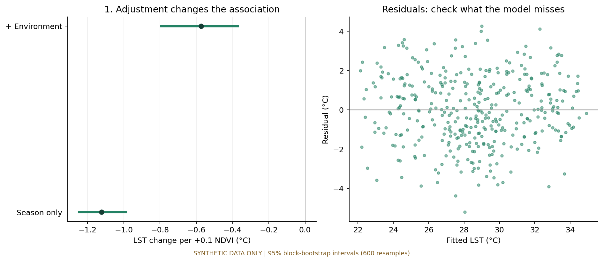
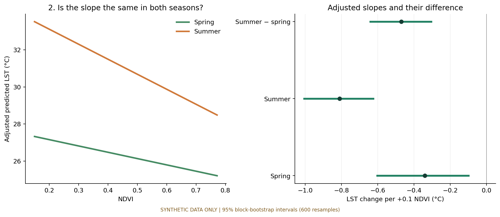

> **교육용 합성자료에 기반한 학술 보고서 예시.** 본문은 실제 도시·Landsat 관측 결과를 제시하지 않는다. 기본 탐색용 36개 표본과 세부목적 분석용 384행은 서로 다른 합성자료이다. 연구 질문을 학술적 목적으로 구체화하는 과정을 보여주기 위해 일상적 질문과 정식 목적 진술을 함께 제시하였다.

### 초록 {#abstract}


**주제어:** NDVI, 지표면 온도, 환경조건 보정, 계절 교호작용, 공간 블록 교차검증, 합성자료

## 1. 연구 배경 {#background}

### 1.1 부산신항 개발과 매립에 따른 공간적 변화

부산신항은 동북아시아 물류 중심 항만의 구축을 목적으로 추진된 대규모 항만 개발사업으로, 부산광역시 강서구 가덕도 북안과 경상남도 창원시 진해구 용원동·웅동·제덕만 일원에 걸쳐 조성되고 있다. 부산광역시의 항만 개발 현황에 따르면 부산신항 개발은 1995년부터 시작되었으며, 부두와 항만 배후단지, 도로 및 철도 등 대규모 기반시설의 확충이 단계적으로 진행되어 왔다[[1]](https://www.busan.go.kr/depart/ocean).

부산신항 개발은 기존 해안지역에 항만시설과 물류단지를 조성하기 위한 매립 및 부지 확장을 포함한다. 이러한 과정에서 기존 해안과 해수면의 경계가 변화하고, 과거 해역이었던 공간이 항만시설과 육상 기반시설로 전환되었다. 부산신항은 장기간에 걸쳐 여러 구간에서 개발이 진행된 지역이므로, 개발 시기에 따라 해안선의 형태와 육상·해양 공간의 구성이 달라졌다는 특징을 가진다.

이처럼 대규모 매립이 이루어진 지역에서 해안선은 단순한 지리적 경계가 아니라 개발에 따른 공간 구조의 변화를 보여주는 중요한 지표이다. 따라서 부산신항의 개발 과정을 이해하기 위해서는 매립에 따른 해안선의 변화와 그에 따른 주변 공간의 변화를 함께 살펴볼 필요가 있다.


그림 1. 부산신항 매립 전과 후 사진[[2]](https://www.mois.go.kr/cmm/fms/FileDown.do?atchFileId=FILE_00130465XriwqSQ&fileSn=0)

### 1.2 매립에 따른 해안선 및 연안 환경 변화의 중요성

연안지역은 육지와 바다가 만나는 공간으로, 해안선의 형태와 수심, 조류 및 퇴적물의 이동 등 여러 자연적 요인이 상호작용하는 환경이다. 이러한 지역에서 대규모 매립과 해안 구조물의 설치가 이루어지면 기존 해안의 형태뿐만 아니라 주변 해역의 물리적 환경에도 변화가 나타날 가능성이 있다.

특히 방파제와 호안 등 해안 구조물의 조성은 파랑과 조류의 흐름에 영향을 줄 수 있으며, 해저 지형과 퇴적물의 이동에도 영향을 미칠 수 있다. 따라서 매립에 따른 해안선 변화는 단순한 육지 면적의 증가를 의미하는 것이 아니라, 연안 공간의 물리적 구조가 변화하는 과정으로 이해할 필요가 있다.

실제로 새만금 방조제 건설에 따른 연안 환경 변화를 분석한 연구에서는 Landsat 시계열을 활용하여 공사 진행 시기에 따른 해수 내 부유물질 농도의 변화를 확인하였다[[3]](https://www.sciencedirect.com/science/article/abs/pii/S0025326X11005650). 이는 대규모 연안 개발이 이루어지는 과정에서 해안선의 변화와 주변 해역의 환경적 특성을 함께 살펴보는 것이 중요하다는 점을 보여준다.

### 1.3 항만 개발지역 인접 내륙의 지표면 온도 문제

항만 및 산업지역은 컨테이너 야적장, 물류시설, 도로 등 다양한 인공시설이 밀집한 공간으로, 일반적인 주거지역이나 자연지역과는 다른 토지 이용 특성을 가진다. 특히 대규모 인공 지표면이 형성된 지역에서는 태양복사에너지의 흡수와 방출 특성이 달라지면서 주변 지역과 구분되는 지표면 온도(Land Surface Temperature, LST) 차이가 나타난다.

부산과 대구를 대상으로 위성 기반 지표면 온도 자료를 활용하여 도시열섬의 시공간적 특성을 분석한 연구에서는 부산의 여름철 최대 지표면 도시열섬 강도가 약 7℃로 나타났으며, 부산의 산업지역에서는 최대 43℃의 지표면 온도가 관측되었다[[4]](https://www.mdpi.com/2072-4292/17/23/3815). 또한 산업지역과 상업지역, 주거지역 사이에서 열환경의 차이가 나타났으며, 토지 이용의 밀도와 공간적 구성에 따라 온도 분포가 달라지는 특성이 확인되었다.


그림 2. 부산 지역 2020년~2023년 LST 그래프 (빨강: 공업지역, 파랑: 상업지역, 노랑: 농업지역, 초록: 산림지역, 연두: 초지, 분홍: 주거지역)[4]

이러한 지표면 온도의 상승은 단순한 미기후 변화를 넘어 인접 지역 주민의 건강과 직결되는 사회적 문제로 이어질 수 있다. 위성 관측 지표면 온도와 폭염 피해의 상관관계를 분석한 연구에 따르면, 2003년 파리 폭염 당시 지표면 온도가 높게 나타난 지역에 거주하는 고령층의 사망 위험이 주변 지역에 비해 약 2.2배 높게 나타났다[5]. 이처럼 높은 지표면 온도는 폭염 시 온열질환 발생 및 건강 취약계층의 피해를 가중하는 주요 요인으로 작용한다.

부산신항 역시 대규모 항만시설과 물류단지가 집적된 지역이라는 점에서 인접한 주거 및 내륙지역의 지표면 온도 변화를 면밀히 살펴볼 필요가 있다. 항만·물류 시설과 인접 내륙지역은 토지 이용과 피복 특성이 상이하므로, 매립과 개발에 따른 지역별 지표면 온도 분포의 차이를 파악하는 것은 연안 도시의 환경적·사회적 영향을 이해하는 데 중요한 의미를 가진다.


그림 3. 유럽 지역별 수목 지역·수목이 없는 도시 녹지·시가화 지역 간 여름철 지표면 온도 차이.[6]

### 1.4 매립 및 항만 개발 주변 해역의 탁도 문제

연안 해역의 탁도는 물속에 존재하는 부유물질과 입자성 물질 등에 의해 물의 투명도가 감소하는 정도를 나타내는 환경적 특성이다. 부유물질은 해수의 빛 투과율을 저하시켜 저서 생태계에 영향을 미치며, 연안 해양환경의 상태를 이해하는 데 중요한 지표로 활용된다.

대규모 매립과 항만 건설 과정에서는 준설, 토사 이동, 해저 지형 변화 등으로 인해 해역 내 부유물질의 분포가 달라질 가능성이 있다. 또한 조류와 해류의 흐름, 강우 및 하천 유입 등 자연적인 요인도 해역의 탁도에 영향을 줄 수 있으므로, 연안 해역의 탁도는 다양한 요인이 복합적으로 작용하는 환경적 지표로 이해해야 한다.

부산 연안 해역의 투명도와 부유물질 분포를 분석한 선행연구에서는 2011년부터 2022년까지의 관측자료를 바탕으로 해역별 부유물질 농도와 투명도의 차이를 확인한 연구 사례가 있다. 특히 부산신항 내측 해역에서는 저층 부유물질 농도가 최대 92.6mg/L로 관측되었으며, 부산 연안 해역이 위치에 따라 서로 다른 부유물질 분포 특성을 보이는 것으로 나타났다[7]. 또한 부산신항 준설과 관련된 해양환경 모니터링 연구에서도 신항 및 진해만 주변의 관측 지점을 대상으로 부유물질 농도의 시기별 변화와 공간적 분포가 분석되었다[[8]](https://www.mdpi.com/2073-4441/17/6/852).


그림 4. 진해신항 부유사 피해.[9]

이러한 부유물질 농도 상승과 탁도 변화는 해양생태계 교란뿐만 아니라 지역 어업 환경에도 영향을 미칠 수 있다. 부산신항과 인접한 진해만 일대는 굴, 피조개 등 패류 양식과 연안 어업이 활발히 이루어지는 해역으로, 부유사의 확산과 침적은 양식 생물의 생육 저하 등 어업 활동에 잠재적인 피해를 초래할 우려가 있다. 따라서 부산신항 개발에 따른 주변 해역의 탁도 변화를 시공간적으로 관측하는 것은 연안 환경 보전과 지역 수산업 보호 측면에서 중요한 과제이다.

### 1.5 부산신항 주변 환경 변화에 대한 종합적 관심의 필요성

부산신항은 장기간에 걸쳐 대규모 매립과 항만시설 및 배후단지 개발이 이루어진 지역으로, 개발 과정에서 육상과 해양의 공간적 구성이 변화해 왔다. 이러한 공간적 변화는 해안선의 형태뿐만 아니라 인접 내륙의 열환경과 주변 해역의 환경적 특성을 함께 살펴볼 필요성을 제기한다.

기존 연구에서는 부산의 산업지역을 중심으로 지표면 온도의 공간적 차이가 확인되었으며, 부산신항 주변 해역에서도 부유물질 농도와 투명도의 지역별 차이가 관측된 바 있다. 이러한 환경적 특성은 각각의 공간과 시기에 따라 다르게 나타날 수 있으므로, 특정 지역의 개발 과정을 이해하기 위해서는 육상과 해양을 구분하여 환경 지표의 변화를 살펴볼 필요가 있다.

특히 부산신항과 같이 매립이 단계적으로 진행된 지역은 해안선의 변화와 인접 내륙 및 주변 해역의 환경적 특성을 함께 이해할 수 있는 중요한 사례이다. 따라서 부산신항의 매립 구간을 중심으로 해안선 변화와 인접 내륙의 지표면 온도, 주변 해역의 탁도 지표가 나타내는 시기별·공간적 특성에 집중한다. 이에 본 연구는 해안선, 지표면 온도, 탁도 지표를 각각 측정하되, 이를 매립 단계라는 같은 시간축에 놓고 비교하고자 한다.


**참고문헌**
1. 부산광역시. 부산신항 개발현황. 부산광역시 해양농수산국. https://www.busan.go.kr/depart/ocean
2. 부산신항 매립 전과 후 사진 https://www.mois.go.kr/cmm/fms/FileDown.do?atchFileId=FILE_00130465XriwqSQ&fileSn=0
3. Ryu, J. H., Won, J. S., & Min, K. D. (2007). Monitoring of suspended sediment variation using Landsat and MODIS in the Saemangeum coastal area of Korea. Continental Shelf Research, 27(17), 2224–2239.
4. Jeon, G.-S.; Kim, W. Resolving Surface Heat Island Effects in Fine-Scale Spatio-Temporal Domains for the Two Warmest Metropolitan Cities of Korea. Remote Sens. 2025, 17, 3815. https://doi.org/10.3390/rs17233815
5. Laaidi K, Zeghnoun A, Dousset B, Bretin P, Vandentorren S, Giraudet E, Beaudeau P. The impact of heat islands on mortality in Paris during the August 2003 heat wave. Environ Health Perspect. 2012 Feb;120(2):254-9. doi: 10.1289/ehp.1103532. Epub 2011 Sep 1. PMID: 21885383; PMCID: PMC3279432.
6. Schwaab et al. (2021), Figure 3a 발췌.
7. 이상협(Sang-Hyub Lee), 장성철(Sung-Chul Jang), and 윤한삼(Han-Sam Yoon). "부산 연안 해수의 투명도와 부유물질의 공간 분포 특성에 관한 연구." 한국해양환경·에너지학회지 25.4 (2022): 171-182.
8. Kim, J.; Ghosh, A.; Paul, T.; Yee, J.-J.; Park, S. Assessing the Environmental Impact of Busan New Port Construction in Korea: A Comprehensive Analysis of Water Quality Changes and Suspended Solids in Jinhae Bay. Water 2025, 17, 852. https://doi.org/10.3390/w17060852
9. "진해신항 해상공사 과정서 흙탕물 발생에 어민들 반발", 동행미디어시대, 2026. 03. 17., 황철성 기자

## 2. 연구 질문 {#question}

연구 배경의 분석 문제를 다음 세 질문으로 구체화하였다. 일상적 질문은 문제의식을 표현하고, 학술적 연구 질문은 비교 대상과 조건을 명시한다. 질문 1–3은 다음 절의 세부목적 1–3에 각각 대응한다.

### 2.1 연구 질문 1

> **일상적 질문:** “부산신항에서는 매립이 진행되면서 어느 시기에 어디에서 얼마나 넓은 바다가 육지로 바뀌었을까?”

**학술적 연구 질문.**  2000~2023년 Landsat 위성영상에서 확인되는 부산신항의 매립 구간은 개발 단계별로 어디에 분포하며, 각 단계에서 새로 조성된 매립지의 면적은 얼마인가?

### 2.2 연구 질문 2

> **일상적 질문:** “부산신항 매립지와 주변 내륙에서 여름마다 유독 땅이 뜨거워지는 곳은 어디일까? 매립지에 도로와 야적장이 들어서면서 그런 곳의 위치나 범위도 달라졌을까?”

**학술적 연구 질문.** 부산신항 매립지와 인접 내륙에서 8월 지표면 온도가 상대적으로 높게 관측되는 구역은 어디에서 얼마나 자주 나타나며, 매립지의 토지피복이 변하는 동안 이러한 고온 구역의 위치와 면적은 어떻게 달라졌는가?

### 2.3 연구 질문 3

> **일상적 질문:** “부산신항 주변 바다에서 물이 탁한 곳은 항만 안쪽뿐일까, 아니면 신항에서 멀리 떨어진 바다까지 퍼져 있을까? 매립 진행 상황에 따라 이 분포가 달라졌을까?”

**학술적 연구 질문.** 2000~2023년 여름철 Landsat 위성영상으로 관측한 부산신항 주변 해역에서, 항내와 신항 경계로부터 주변 정규화 탁도지수(NDTI)는 어떻게 분포가 돼있으며, 항내와 외측 해역의 NDTI는 매립 진행 시기에 따라 어떻게 달라졌는가?

## 3. 연구 목적 {#objectives}

### 3.1 전체 연구목적

본 연구의 목적은 **부산신항의 매립 및 항만 개발 과정에서 어느 구간에서 얼마만큼의 연안 수역이 육지로 전환되었는지 밝히고, 매립지와 인접 내륙에서 여름철 고온을 우선 조사할 구역과 주변 해역에서 탁도를 중점적으로 관측할 구역을 제시하는 데 있다.**

이를 위해 먼저 2000~2023년 Landsat 위성영상에서 개발 단계별 해안선 위치와 연안 수역 면적을 비교하여 매립이 집중된 시기와 구간을 파악한다. 육상에서는 매립지와 인접 내륙의 8월 지표면 온도(LST)를 분석하여 **상대적으로 높은 온도가 반복적으로 관측된 구역을 찾고**, 매립지의 토지피복이 변하는 동안 고온 구역의 위치와 면적이 어떻게 달라졌는지 살펴본다. 주변 해역에서는 준설공사 착수 전과 진행 기간의 Sentinel-2 위성영상을 이용하여 항만 내부·인접·외측 해역의 탁도지수(NDTI)를 비교한다. 이를 통해 **상대적으로 높은 지숫값이 어느 시기에 어느 해역에서 얼마나 넓게 나타났는지 파악**하고, **현장 탁도 관측이 필요한 후보 해역을 제시**한다.

### 3.2 세부목적 1 · 부산신항의 시기별 해안선 변화 파악 및 신규 매립면적 정량화

**연구 질문 1의 목적화.** 2000~2023년 Landsat 위성영상에서 추출한 부산신항의 시기별 해안선을 중첩하여, 각 관측 시점 사이에 수역에서 육지로 전환된 매립 구간을 확인하고 그 면적을 산출한다. 이를 통해 어느 **시기에 어느 구간에서 매립이 집중되었는지 밝힌다.**

**필요성 및 평가 지표.** 매립 전후의 같은 위치를 비교하면 수면이 육지로 바뀌면서 나타난 온도 차이까지 포함된다. 이에 본 연구는 온도 관측 범위를 2000년 영상에서 이미 육지로 확인된 용원동 내륙으로 한정한다. 또한 매립지에 가까운 주거지와 멀리 떨어진 산림을 단순 비교하면 토지피복과 고도의 차이가 결과에 반영될 수 있으므로, 두 거리 구간에 공통으로 분포하는 피복 유형과 고도 범위에서 비교한다.

주요 평가 지표는 **촬영일별 지표면 온도 차이(근거리 구역의 LST 중앙값 − 원거리 구역의 LST 중앙값, ℃)**로 한다. 양수이면 해당 날짜에 근거리 구역이, 음수이면 원거리 구역이 더 따뜻했음을 뜻한다. 구름 등으로 두 구역 중 한쪽의 유효 관측 면적이 부족한 날은 비교에서 제외한다. 결과에는 연도별 온도 차이의 중앙값과 함께 실제 비교에 사용한 8월 촬영일 수와 구역별 유효 관측 면적 비율을 제시한다. 이를 바탕으로 관측 가능한 조건에서 매립지와의 거리별 온도 차이의 크기와 방향을 해석한다.

### 3.3 세부목적 2 · 부산신항 매립지와의 거리에 따른 인접 내륙의 8월 지표면 온도 비교

**연구 질문 2의 목적화.** 2000~2024년 매년 8월의 Landsat 위성영상을 활용하여, 부산신항 매립지와의 거리에 따라 창원시 용원동 기존 내륙의 지표면 온도(LST)가 어떻게 다른지 분석한다. 세부목적 1에서 확인한 매립 구역 중 각 영상의 촬영일까지 형성이 확인된 구역의 경계를 기준으로, 용원동 내륙의 각 분석 격자에서 가장 가까운 매립지까지의 거리를 산출한다. 이후 토지피복과 고도가 유사한 근거리·원거리 구역을 선정하여, 같은 촬영일에 관측된 두 구역의 지표면 온도 차이와 그 차이가 여러 해의 8월 관측에서 반복되는지를 평가한다.

**필요성 및 평가 지표.** 매립 직후에는 나지와 매립 토양이 드러나고, 이후 도로·야적장·물류시설 등이 조성되면서 지표면의 재질과 구조가 달라진다. 이 과정에서 매립지 전체의 평균 온도만 비교하면 어느 구역에서 고온이 반복되었는지, 고온 구역의 범위가 어떻게 달라졌는지 파악하기 어렵다. 이에 매년 8월 매립지와 인접 내륙에 동일한 기준을 적용해 고온 구역을 구분하고, 위치별 고온 출현 비율(%)과 연도별 고온 구역 면적(km²)을 주요 평가 지표로 삼는다. 고온 출현 비율은 각 위치에서 지표면 온도를 관측할 수 있었던 연도 중 고온으로 분류된 연도의 비율로 산출한다. 이를 바탕으로 여름철 고온이 반복되는 구역을 지도에 표시하여 현장 온도 조사와 열저감 대책을 우선 검토할 후보지를 제시한다.

### 3.4 세부목적 3 · 부산신항 항내와 항외 해역의 연도별 여름철 탁도지수 분포 파악

**연구 질문 3의 목적화.** 2000~2023년 여름철(6~8월) Landsat 위성영상을 활용하여, 세부목적 1에서 확인한 연도별 매립 과정과 함께 항내의 탁도지수(NDTI) 변화를 살펴본다. 먼저 매립이 진행되는 동안 항내의 NDTI 값은 어느 정도였는지 파악한다. 이어서 항만 입구를 지나 바깥 해역까지 이어지는지 살펴보고, 이어지는 경우 그 범위가 어디까지인지 확인한다.

**필요성 및 평가 지표.** 항내의 탁도지수가 얼마나 높았는지와 높은 값이 어느 해역까지 나타났는지는 서로 다른 정보다. 이에 연도별 항내 NDTI 대표값으로 매립 과정에서 관측된 지수의 수준을 나타내고, 항만 입구에서 바깥쪽으로 높은 NDTI가 이어지는 수역의 범위를 지도에 표시한다. 항외에서 떨어져 나타난 고지수 구역은 별도로 구분한다. 이렇게 파악한 범위는 위성영상에서 높은 값이 공간적으로 이어져 관측된 범위이다.

## 4. 재료 {#materials}

### 4.1 연구 대상과 관측 기간

세부목적 1의 연구 대상은 부산신항 전체 매립사업 구역과 그 주변 수역이다. 2000~2024년 매년 8월의 위성영상에서 같은 구역의 수륙 경계를 비교한다. 예비 코랩의 검색 범위는 동경 128.73°~128.88°, 북위 35.025°~35.135°이다. 이 사각형에는 사업구역 밖의 해안도 포함될 수 있다. 따라서 부산신항 전체의 매립면적을 집계하려면 공식 사업구역도와 대조해 누락된 구간을 포함하고 사업구역 밖의 전환 화소를 제외한 뒤 다시 계산해야 한다. 2000년에 이미 육지였던 구역은 이후의 신규 매립면적 집계에서 제외한다.

세부목적 2는 창원시 진해구 용원동 법정동 경계 안에서 2000년 당시 육지로 관측된 구역을 대상으로 한다. 세부목적 1에서 확인한 매립지 경계를 거리 측정의 출발선으로 삼고, 온도는 그 경계 바깥의 기존 내륙에서 비교한다. 관측 기간은 2000~2024년 매년 8월 1일~31일이다. 계절에 따른 차이를 줄이기 위해 연도마다 같은 달을 사용한다. 25년은 자료의 검색 기간이며, 실제 온도 비교에 사용할 수 있는 연도 수는 품질 기준을 적용한 뒤 산정한다.


### 4.2 Landsat 지표면 반사도와 지표면 온도

미국 지질조사국(USGS)의 Landsat Collection 2 Tier 1 Level-2 자료를 Google Earth Engine에서 조회한다.[^landsat] 코랩은 2000~2011년에 Landsat 5·7, 2012년에 Landsat 7, 2013~2020년에 Landsat 8, 2021~2024년에 Landsat 8·9를 검색한다. 실제 사용 센서와 촬영일은 해당 연도 8월의 영상 목록에 따라 결정된다. 위치와 면적을 계산할 때에는 UTM 52N 좌표계(EPSG:32652)를 사용한다.

수륙 경계 추출에는 30 m 지표면 반사도를 사용한다. 녹색과 근적외선 밴드는 Landsat 5·7에서 각각 SR_B2와 SR_B4, Landsat 8·9에서 각각 SR_B3와 SR_B5이다. 각 밴드의 저장값(DN)을 반사도 ρ로 환산한 뒤 정규수역지수(NDWI)를 계산한다. 수역과 육지의 경계를 구하는 식은 다음과 같다.


온도 분석에는 지표면 온도 밴드가 있는 L2SP 영상만 사용한다. Landsat 5·7에서는 ST_B6, Landsat 8·9에서는 ST_B10의 저장값을 다음 식으로 섭씨온도(°C)로 환산한다. 센서별 열 관측 해상도 차이를 고려하여 육상 온도는 120 m 공통 격자로 집계한다. 이 값은 위성 통과 시점에 관측된 지표면의 온도를 나타낸다.


### 4.3 인접 내륙(용원동)의 경계와 해안선 검증자료

용원동 경계는 V-World의 2023년 7월 29일 자료를 단순화한 공개 GeoJSON을 사용한다.[^boundary] 이 경계는 용원동의 외곽을 정하는 용도로 사용하며, 2000년의 육지 범위는 당시 위성영상에서 별도로 추출한다. 경계 파일만으로는 2000년 이전에 이미 조성된 매립지를 식별하기 어려우므로, 해당 구역은 과거 항공사진이나 사업도면으로 확인되는 경우에만 추가로 제외한다.

부산신항의 해안선 위치를 검증할 때에는 Landsat 촬영 시기와 가깝고 수륙 경계를 판독할 수 있는 정사영상 또는 기준 해안선을 사용한다. 면적 검증에는 같은 사업 구간과 시기의 매립면적을 확인할 수 있는 준공도면 등을 사용한다. 각 기준자료의 제작기관, 촬영일 또는 준공일, 좌표계와 비교 구간을 기록한다. 현재 검증에 사용할 독립 기준자료와 측선별 위치오차는 확정 전이다.

### 4.4 자료의 한계

위성영상에서 추출한 수륙 경계는 촬영 당시의 수면 상태를 반영한다. 갯벌처럼 조위에 따라 노출 범위가 달라지는 곳에서는 한 시점의 수역 감소가 매립처럼 보일 수 있으므로, 이후 영상에서 육지가 유지되는지와 자연색 영상에서 부지 조성 형태가 확인되는지를 함께 살펴볼 필요가 있다. 또한 본 연구에서 산출하는 신규 매립면적은 2000년 이후 관측 시점 사이에 확인되는 변화량이므로, 사업 시작 이후의 전체 누적 매립면적과는 범위가 다르다.

용원동의 지표면 온도 자료는 30 m 격자로 제공되지만, 열적외선 센서의 원래 관측 해상도는 이보다 거칠다. 따라서 고온이 반복되는 위치는 개별 건물이나 도로 한 곳보다 인접한 픽셀들이 이루는 구역 단위로 해석한다. 해역의 NDTI 역시 수면의 분광 반사 특성으로 산출한 상대 지표이므로, 높은 값이 반복된 구간은 현장 탁도와 부유물질 농도를 우선 확인할 후보지로 해석한다. 강우·하천 유입·조류 등도 부유물질 분포에 영향을 줄 수 있어, 해당 구간의 NDTI만으로 매립이나 준설의 기여도를 산정하기는 어렵다.


## 5. 방법 {#method}

### 5.1 영상 전처리와 유효 관측일 산정

Google Colab에서 연구 범위와 기간으로 영상을 검색한 뒤, QA_PIXEL과 QA_RADSAT 품질 밴드를 이용해 채움값, 구름, 구름 그림자, 눈 및 포화 화소 등을 제외한다. 같은 날 여러 영상이 겹치면 날짜별 평균을 먼저 계산한다. 따라서 하루에 두 영상이 겹친 위치도 유효 관측일은 하루로 계산된다. 각 격자에서 서로 다른 8월 촬영일이 두 날 이상 확보될 때 연도 대표값으로 일별 값의 중앙값을 사용한다. 한 번의 촬영에만 의존하는 경우를 줄이기 위한 예비 기준이다.

### 5.2 세부목적 1의 분석 · 부산신항의 시기별 신규 매립면적 산정

**수륙 경계 추출.** 부산신항 전체 매립사업 구간을 포함하도록 분석 범위를 고정하고, 2000~2024년 매년 8월 Landsat 영상에서 정규수역지수(NDWI)를 계산한다. NDWI는 녹색광과 근적외선 반사도를 이용하여 (Green − NIR) / (Green + NIR)로 산출한다. 구름과 구름 그림자 등에 가려진 화소를 제외하고, 같은 날 겹쳐 촬영된 영상은 하나의 관측일로 통합한다. 각 화소에서 8월 유효 관측일이 2일 이상이면 일별 NDWI의 중앙값을 해당 연도의 대표값으로 사용한다. 예비 분석에서는 NDWI가 0을 초과하면 수역, 0 이하면 육지로 분류한다. 대표 연도의 자연색 영상과 대조하고 임계값을 −0.05, 0, +0.05로 바꾸었을 때 경계가 얼마나 달라지는지 확인한 뒤, 최종 선정한 기준을 모든 연도에 동일하게 적용한다.

**신규 매립 구간 판별.** 같은 위치에서 앞선 유효 연도에 수역이었고 이후 처음 육지로 분류된 화소를 추출한다. 다음 유효 연도에도 육지가 유지되면 지속적인 육지 전환 후보로 분류하고, 자연색 영상에서 호안이나 부두가 조성된 형태와 일치하는지 확인한다. 조위에 따라 갯벌이 일시적으로 드러난 곳이나 구름 때문에 후속 확인이 어려운 곳은 미확정 구간으로 남긴다. 같은 이유로 2024년에 처음 육지로 나타난 화소는 후속 관측이 확보될 때까지 잠정 후보로 표시한다.

**면적 산정 및 결과 제시.** 신규 매립으로 확인된 30 m × 30 m 화소 한 개의 면적은 0.0009 km²이다. 이를 관측 기간별로 합산하여 신규 매립면적을 구하고, 같은 위치가 여러 해에 중복 합산되지 않도록 한다. 예를 들어 2010년에 수역, 2011년에 결측, 2012년에 육지로 관측되고 이후에도 육지가 유지됐다면, 해당 면적은 ‘2010~2012년 사이 전환 구간’으로 기록한다. 연도별 그래프에서는 2012년을 최초 육지 관측연도로 표시하고, 관측 공백을 거쳐 확인된 면적을 구분한다. 최종적으로 자연색 영상 위에 시기별 해안선과 신규 매립 구간을 표시하고, 신규 면적과 누적 면적을 그래프로 제시한다. 해안선의 위치 정확도는 독립 기준자료를 확보한 구간에서 수직 측선별 이격거리의 RMSE(m)로 평가한다.

### 5.3 세부목적 2의 분석 · 인접 내륙(용원동)의 여름철 반복 고온 구역과 매립지 거리별 온도 비교

**분석 범위와 대표 온도 산출.** 창원시 진해구 용원동 법정동 경계 안에서 2000년 당시 육지로 관측된 구역을 고정하여, 이후 바다에서 육지로 바뀐 매립지가 온도 비교 대상에 들어가는 것을 방지한다. 기존 육지의 범위를 정할 때에는 2000년 4~10월 광학영상을 활용하고, 지표면 온도(LST)는 2000~2024년 매년 8월 1일~31일 영상만 사용한다. 관측 당시에도 육지이고 온도값이 유효한 위치를 120 m 공통 격자로 집계한다. 각 격자에서 서로 다른 8월 관측일이 2일 이상 확보되면 일별 LST의 중앙값을 해당 연도의 8월 대표 지표면 온도(℃)로 사용한다. 고정 내륙 면적의 70% 이상에서 대표 온도를 구할 수 있는 해를 연도 간 비교에 포함한다. 나머지 해는 유효 면적 비율과 함께 ‘관측 부족’으로 기록한다.

**반복 고온 구역 선정.** 품질 기준을 충족한 각 연도에 용원동 기존 내륙의 유효 격자를 대상으로 8월 대표 LST의 90백분위수를 구한다. 이 값 이상인 격자를 그해의 상대 고온 구역으로 분류한다. 이때 상위 10%는 같은 해 용원동 안에서 상대적으로 뜨거웠던 위치를 찾기 위한 연구 기준이다. 각 위치에서 고온으로 분류된 연도 수를 그 위치의 유효 관측연도 수로 나누어 고온 출현 비율을 계산한다. 예를 들어 유효하게 관측된 10개 연도 중 6개 연도에 고온이었다면 출현 비율은 60%이다. 유효 연도가 5년 이상인 위치에 대해서만 비율을 표시하고, 값이 높을수록 진한 빨간색, 관측이 부족한 위치는 회색으로 나타낸다.

```text
고온 출현 비율(%) = 고온으로 분류된 연도 수 / 8월 대표 온도를 산출할 수 있었던 연도 수 × 100
```

고온 출현 비율과 유효 관측 연도 수를 함께 지도에 표시한다. 여러 해에 걸쳐 높은 출현 비율을 보이는 픽셀이 모여 있는 곳을 찾아 여름철 현장 온도 조사를 우선할 후보 구역으로 제시한다.

**매립지로부터의 거리별 온도 비교.**  세부목적 1에서 해당 관측 시점까지 형성이 확인된 매립지의 외곽 경계를 기준으로, 용원동 기존 내륙의 각 격자 중심까지 최단거리를 계산한다. 거리대의 범위는 온도 결과를 보기 전에 거리별 격자 수와 토지피복·고도 구성을 확인해 정하며, 선정한 거리 기준은 전 기간에 동일하게 적용한다. 가까운 거리대와 먼 거리대를 비교할 때에는 두 구역이 함께 관측된 동일한 8월 촬영일을 사용한다. 유사한 토지피복·고도 조건에서 각 거리대의 중앙 LST를 구하고, 가까운 거리대의 값에서 먼 거리대의 값을 빼 일별 온도 차이(℃)를 산출한다. 연도별로는 이 차이의 중앙값과 비교에 사용한 촬영일 수를 함께 제시한다. 이를 통해 매립지 가까이에서 상대적으로 높은 온도가 반복됐는지 살펴보되, 관측된 차이에는 해안과의 거리나 토지 이용의 영향도 함께 반영될 수 있음을 고려한다.

### 5.4 세부목적 3의 분석 · 부산신항 주변 해역의 겨울철 반복 고지수 구간 파악

**겨울철 대표 탁도지수 산출.** 부산신항 주변 해역의 분석 범위를 고정하고, 매년 1월과 2월을 하나의 겨울철 관측 기간으로 설정한다. 촬영일별로 영상에서 수역을 판별한 뒤, 유효 수역 픽셀의 적색 및 녹색 반사도를 이용하여 정규화 차이 탁도지수(NDTI)를 산출한다. 각 위치에서 두 달 동안 관측된 NDTI의 중앙값을 해당 연도의 겨울철 대표값으로 사용한다.

```text
NDTI = (Red − Green) / (Red + Green)

Red   = red band reflectance
Green = green band reflectance
```

**높은 NDTI가 반복되는 구간 선정.** 매년 겨울 분석 범위 내 유효 수역에서 대표 NDTI가 상위 10%에 해당하는 위치를 고지수 구역으로 분류한다. 각 위치에서 고지수로 분류된 겨울 수를 유효하게 관측된 겨울 수로 나누어 고지수 출현 비율을 산출한다.

```text
고지수 출현 비율(%) = 고지수로 분류된 겨울 수 / 겨울철 대표 NDTI를 산출할 수 있었던 겨울 수 × 100
```

연도별로 고지수 구역의 위치와 면적(km²)을 기록하고, 해당 겨울의 유효 수역 면적을 함께 제시한다. 해마다 유효 수역의 일정 비율을 선정하므로, 분석의 초점은 주변보다 높은 NDTI가 여러 겨울에 걸쳐 **어느 위치에서 반복되는지**에 둔다. 이러한 구간을 지도화하여 양식장 입지 검토 시 겨울철 탁도와 부유물질 농도를 현장에서 우선 확인할 후보 해역을 제시한다.

### 5.5 관측자료의 오차 점검 및 재현성 확보

**결측 및 오분류 점검.** 구름이나 영상 결측으로 관측할 수 없었던 시기는 각 위치의 출현 비율 계산에서 제외한다. 예를 들어 24개 연도 중 18개 연도에서만 유효한 값이 확보되었다면, 해당 위치의 출현 비율은 18개 연도를 기준으로 계산한다. 출현 비율을 제시할 때에는 실제 관측 연도 수도 함께 표시한다. 매립 분석에서는 갯벌의 일시적 노출을 신규 매립으로 잘못 집계하지 않도록 자연색 영상과 이후의 수륙 경계를 대조하고, 육지 전환 여부를 확인하기 어려운 곳은 미확정 구역으로 기록한다.

**재현성 확보.** 사용한 Landsat 영상의 제품 식별자와 촬영일, 분석 구역의 경계 좌표, 좌표계와 격자 크기, 센서별 사용 밴드를 Colab 노트북에 기록한다. 구름·결측 처리 조건, 연도별 대표값 산출 방식, 분류 기준과 면적 계산 방법도 실제 실행 순서에 맞춰 남긴다. 최종 지도와 면적 집계표에는 사용한 관측 기간을 명시하여 각 결과가 어느 시기의 자료에서 도출되었는지 확인할 수 있도록 한다.

## 6. 결과 {#results}

### 6.1 기초 탐색: NDVI–LST 분포 및 집단 평균


**그림 1.** 기본 합성자료의 NDVI–LST 관계. x축은 NDVI, y축은 LST(°C)이며 모든 점은 가상 표본이다.

36개 표본의 Pearson 상관계수는 **r = −0.92**로 나타났다. 이는 생성식에 설정된 음의 관계와 일치한다.


**그림 2.** 기본 합성자료의 집단별 평균 LST. NDVI 0.45 미만 집단은 **33.9°C**, 0.45 이상 집단은 **30.1°C**였으며 평균 차이는 약 **3.7°C**였다. 이 비교는 표본 내 기술통계이며 모집단 차이의 검정 결과가 아니다.

[기초 탐색 노트북]({{ site.github.repository_url }}/blob/main/02_개인분석/01_demo_analysis.ipynb) · [그림 생성 코드]({{ site.github.repository_url }}/blob/main/01_공통코드/make_demo.py) · [계산 수치]({{ site.github.repository_url }}/blob/main/03_분석결과/summary.json)

### 6.2 세부목적 1 · 환경조건 보정에 따른 연관성 변화 {#deep-confounding}

**대응 연구 질문:** 다른 환경조건을 고려한 이후에도 NDVI–LST의 음의 연관성이 유지되는가?



**그림 3.** 왼쪽은 NDVI 0.1 증가당 계수와 블록 bootstrap 95% 구간, 오른쪽은 모형 B의 적합값과 잔차(관측값−적합값)이다.

계절만 보정한 모형 A의 계수는 **−1.12°C**(95% 구간 −1.25~−0.99°C), 환경조건을 추가한 모형 B의 계수는 **−0.57°C**(−0.79~−0.37°C)였다. 보정 후 계수의 절대 크기는 감소하였으나 음의 방향은 유지되었다. 두 구간 모두 0을 포함하지 않았다. 이 결과는 설정된 모형과 합성 표본에서의 조건부 연관성을 나타내며 환경조건 보정 자체가 인과효과의 식별을 의미하지는 않는다.

[세부목적 1 노트북]({{ site.github.repository_url }}/blob/main/02_개인분석/02_confounding.ipynb)

### 6.3 세부목적 2 · 계절별 연관성의 이질성 {#deep-seasonality}

**대응 연구 질문:** 환경조건을 보정한 NDVI–LST 기울기는 봄과 여름 사이에 차이가 있는가?



**그림 4.** 왼쪽은 다른 환경변수를 전체 표본 평균으로 고정한 계절별 예측선이며 개별 지점의 관측값이 아니다. 오른쪽은 NDVI 0.1 증가당 봄·여름 기울기 및 여름−봄 차이와 블록 bootstrap 95% 구간이다.

모형 C의 봄 기울기는 **−0.34°C**(95% 구간 −0.60~−0.10°C), 여름 기울기는 **−0.81°C**(−1.01~−0.63°C)였다. 여름−봄 차이는 **−0.47°C**(−0.64~−0.31°C)로, 여름의 음의 기울기가 더 크게 나타났다. 차이의 구간이 0을 포함하지 않는다는 결과는 현재 모형과 합성 표본에서 계절별 기울기를 구분할 근거를 제공한다. 이는 생성식에 포함된 계절 차이의 추정 결과이다.

[세부목적 2 노트북]({{ site.github.repository_url }}/blob/main/02_개인분석/03_seasonality.ipynb)

### 6.4 세부목적 3 · 품질 기준 민감도 및 공간 예측 성능 {#deep-robustness}

**대응 연구 질문:** 품질 기준을 변경해도 계절별 추정이 유지되는가? NDVI의 추가가 학습에 포함되지 않은 공간 블록의 예측에 기여하는가?


**그림 5.** 왼쪽은 품질 기준별 여름 기울기와 블록 bootstrap 95% 구간이다. 오른쪽은 임의 행 분할 및 블록 분할에서 기준 모형과 확장 모형의 RMSE를 비교한다. RMSE 막대에는 신뢰구간을 표시하지 않았다.

필터 없음, 유효 관측 비율 0.5 이상, 0.7 이상에서 표본 수는 각각 **384, 278, 182행**이었다. 여름 기울기는 **−0.81, −0.82, −0.87°C/NDVI 0.1**이었으며, 95% 구간은 각각 **−1.01~−0.63, −1.03~−0.62, −1.14~−0.65°C**였다. 모든 조건에서 24개 블록이 유지되었고, 여름 계수의 방향과 0을 포함하지 않는 구간이 유지되었다. 가장 엄격한 기준의 구간은 필터를 적용하지 않은 경우보다 넓었다. 봄 기울기와 계절 차이를 포함한 전체 결과는 계산 파일에 제시하였다.

블록 교차검증 RMSE는 기준 모형 **1.91°C**, 확장 모형 **1.81°C**로, NDVI와 계절 교호작용 추가에 따른 감소량은 약 **0.10°C**였다. 확장 모형의 임의 행 분할 RMSE는 **1.74°C**로 블록 분할보다 낮았다. 이 비교는 품질 필터 적용 전 384행에서 수행하였다. 성능 차이의 유의성 검정은 수행하지 않았다.

[세부목적 3 노트북]({{ site.github.repository_url }}/blob/main/02_개인분석/04_robustness.ipynb) · [전체 추정값·구간·fold별 오차 및 배정]({{ site.github.repository_url }}/blob/main/03_분석결과/advanced_summary.json)

## 7. 토의 {#discussion}

### 7.1 환경조건 보정과 계절 구분의 해석적 의미

세부목적 1에서 환경조건 보정 후 NDVI 계수의 절대 크기가 감소한 결과는, 같은 자료에서도 고려하는 조건에 따라 관계의 추정치가 달라질 수 있음을 보여준다. 본 생성 과정은 NDVI와 고도·불투수면 비율 사이의 관련성을 의도적으로 포함하므로, 이 변화는 환경조건과 함께 나타나는 관계를 검토해야 한다는 설계 취지와 부합한다. 다만 계수의 감소량을 고도 또는 불투수면이 각각 설명하는 인과적 기여율로 해석할 수는 없다. 또한 모형 B는 계절별 동일 기울기를 가정하므로 그 계수는 이 가정 아래의 공통 연관성이다.

세부목적 2는 공통 기울기만으로 요약할 때 소실될 수 있는 계절별 차이를 제시한다. 봄과 여름의 기울기를 구분한 결과는 단일 관계의 크기를 정교화하는 것뿐 아니라, 추정값의 적용 조건을 명시한다는 의미를 갖는다. 그러나 본 자료에서 계절 차이는 이미 생성식에 부여되어 있다. 따라서 이를 녹지의 실제 계절별 냉각 기작을 발견한 결과로 해석할 수 없으며, 관측자료에서 같은 패턴이 나타나더라도 그 기작을 논하려면 추가 근거가 필요하다.

### 7.2 추정의 안정성과 예측 기여의 구분

세부목적 3에서 품질 기준 변경 후에도 여름 계수의 음의 방향이 유지된 결과는 검토한 세 기준 내에서의 방향 안정성을 보여준다. 반면 표본 수 감소와 함께 구간이 넓어진 결과는 엄격한 자료 선택이 곧 추정 정밀도의 향상을 의미하지 않음을 나타낸다. 본 자료의 품질 변수는 인위적으로 생성되었으므로, 실제 결측이 특정 지역·날짜·계절에 집중되는 상황에서의 선택 편향까지 검증한 것은 아니다.

블록 교차검증에서 확장 모형의 RMSE 감소는 약 0.10°C였다. 이 차이의 실용적 중요성은 사용 목적과 허용 오차를 함께 고려하여 판단해야 하며, 현재 예시만으로 충분한 개선이라고 규정할 수 없다. 계수 구간이 0을 포함하지 않는다는 근거는 특정 모형의 연관성에 관한 것이고, RMSE 감소는 보지 않은 표본의 예측 오차에 관한 것이다. 두 지표를 함께 제시함으로써 관계의 존재와 예측상의 유용성을 구별할 수 있다.

임의 행 분할의 오차가 블록 분할보다 낮았다는 결과는 평가 단위에 따라 성능 추정이 달라질 수 있음을 보여준다. 다만 이 차이는 단일 분할 실험에서 얻은 값이며, 그 차이를 일반적인 편향의 크기로 단정하지 않는다. 본 분석은 좌표가 없는 블록을 사용하므로 실제 공간 자기상관의 거리 또는 타 도시 적용 성능을 평가한 것도 아니다.

### 7.3 한계 및 후속 연구 설계

첫째, 본 연구는 단일 생성식과 고정 seed에서 얻은 합성자료 분석이다. 추정 구간과 교차검증 결과를 실제 도시의 모집단 특성으로 일반화할 수 없으며, 여러 생성 조건에서 방법의 성능을 비교한 포괄적 시뮬레이션 연구도 아니다. 후속 검토에서는 오차 크기·변수 간 관련성·블록 수·결측 구조를 달리하여 결과의 의존성을 평가할 수 있다.

둘째, 선형회귀는 지정된 함수 형태와 포함 변수에 의존한다. 비선형 관계, 누락된 환경요인 및 변수 측정오차는 추정에 영향을 줄 수 있다. 블록 bootstrap 역시 블록 간 독립성을 전제로 하며 24개 블록과 600회 재표집에서 얻은 구간의 정밀도에는 제약이 있다. 계절별 구간의 분리만으로 생태·물리적 기작을 확정하지 않는다.

셋째, 두 계절과 단일 6-fold 분할은 연중 변화·장기 추세·미래 연도 예측을 평가하기에 충분하지 않다. 실제 위성자료 연구로 확장할 때에는 NDVI와 LST의 공간·시간 대응, 구름 및 수면 처리, 계절별 관측일과 표본 대표성을 확인하고 목적에 맞는 공간·시간 분할을 설계해야 한다. 지표면 온도에 관한 결과를 기온이나 일평균 온도에 대한 결론으로 대체해서도 안 된다.

마지막으로 본 예시의 학술적 기능은 연구 질문과 분석·해석 범위의 대응을 시연하는 데 있다. 실증적 신규성이나 선행연구 대비 우수성을 주장하지 않는다. 실제 보고서에서는 관련 일차 문헌을 검토하여 연구 공백을 설정하고, 결과의 일치·차이를 대상 지역·기간·표본 단위·방법 차이와 연결해 논의해야 한다.

## 8. 결론 {#conclusion}

본 연구는 합성자료를 이용하여 NDVI–LST 관계를 환경조건 보정, 계절별 이질성, 자료 선택 민감도 및 공간 예측 성능의 측면에서 평가하였다. 세부목적별 결론은 다음과 같다.

1. **세부목적 1 — 조건부 연관성.** NDVI 0.1 증가당 계수는 계절만 보정했을 때 −1.12°C, 환경조건을 추가했을 때 −0.57°C였다. 이 결과는 관계의 크기를 제시할 때 보정 조건을 명시해야 함을 보여주며, 녹지의 인과적 냉각 효과를 추정한 결과는 아니다.
2. **세부목적 2 — 계절별 이질성.** 봄과 여름의 기울기는 각각 −0.34°C와 −0.81°C였고, 여름−봄 차이는 −0.47°C(95% 구간 −0.64~−0.31°C)였다. 설정된 생성 구조와 모형 아래에서 하나의 공통 기울기만으로는 계절 차이를 충분히 나타내지 못하였다.
3. **세부목적 3 — 민감도와 예측 성능.** 세 품질 기준에서 여름 계수의 방향은 유지되었으나, 가장 엄격한 조건에서는 표본 수가 줄고 구간이 넓어졌다. NDVI와 교호작용 추가에 따른 블록 교차검증 RMSE 감소는 약 0.10°C였다. 관계 추정의 안정성과 예측 기여는 구분하여 판단할 필요가 있다.

이상의 결과는 연구 질문을 조건·추정량·평가 기준이 명시된 세부목적으로 구체화하고, 각 목적에 대응하는 근거와 한계를 제시하는 분석 절차를 예시한다. 실제 도시 환경에 대한 결론은 관측자료와 적절한 검증 설계에 기반한 후속 분석을 통해 별도로 도출해야 한다.

---

### 부록 · 재현성 및 연구 기여 {#reproduce}

#### 직접 실행하기

[Colab에서 합성자료 노트북 열기](https://colab.research.google.com/github/{{ site.github.owner_name }}/{{ site.github.repository_name }}/blob/main/02_개인분석/01_demo_analysis.ipynb)

심화 분석도 EE 인증 없이 실행됩니다. 공통 자료 준비 블록을 먼저 실행하고 해당 분석 셀을 따라가세요.

- [세부목적 1: 환경조건 보정 — Colab](https://colab.research.google.com/github/{{ site.github.owner_name }}/{{ site.github.repository_name }}/blob/main/02_개인분석/02_confounding.ipynb)
- [세부목적 2: 계절별 관계 — Colab](https://colab.research.google.com/github/{{ site.github.owner_name }}/{{ site.github.repository_name }}/blob/main/02_개인분석/03_seasonality.ipynb)
- [세부목적 3: 강건성·공간 검증 — Colab](https://colab.research.google.com/github/{{ site.github.owner_name }}/{{ site.github.repository_name }}/blob/main/02_개인분석/04_robustness.ipynb)

GitHub 저장소의 코드를 로컬에서 실행하려면 다음을 사용합니다.

```text
python -m pip install -r requirements.txt
python 01_공통코드/make_demo.py
python 01_공통코드/advanced_analysis.py
```

예시 합성 분석은 2026-10-26 로컬 환경에서 실행 확인했습니다. GEE 시작 노트북의 실제 서버 실행은 검증하지 않았습니다.

[별도 연습: GEE 시작 노트북](https://colab.research.google.com/github/{{ site.github.owner_name }}/{{ site.github.repository_name }}/blob/main/01_공통코드/01_gee_starter.ipynb)

#### 조원별 기여를 쓰는 방법

실제 조에서는 “조원 A: 공통 전처리 및 품질 점검 / 조원 B: 공간 비교 / 조원 C: 시계열 분석”처럼 **분석 내용과 연결된 기여**를 기록하세요. 위 역할은 작성 예시이며 실제 참여자 명단이 아닙니다. 별도 주간 보고서는 만들지 않아도 됩니다.

#### 자료와 참고

- 합성자료: 이 저장소의 생성 코드, seed 2026(기본), 20261026(심화). 외부 관측 데이터 사용 없음.
- [Landsat 8 Collection 2 Level-2 공식 자료 설명](https://developers.google.com/earth-engine/datasets/catalog/LANDSAT_LC08_C02_T1_L2)
- [학생 사용 안내]({{ site.github.repository_url }}/blob/main/STUDENT_GUIDE.md)
- [빈 보고서 틀](report-template.html)

- [섹션별 작성 지침]({{ site.github.repository_url }}/blob/main/05_보고서양식/섹션별_작성지침.md)


#### 연구 배경 참고문헌

- Voogt, J. A., & Oke, T. R. (2003). Thermal remote sensing of urban climates. *Remote Sensing of Environment, 86*(3), 370–384. [https://doi.org/10.1016/S0034-4257(03)00079-8](https://doi.org/10.1016/S0034-4257(03)00079-8).
- Schwaab, J., Meier, R., Mussetti, G., Seneviratne, S., Bürgi, C., & Davin, E. L. (2021). The role of urban trees in reducing land surface temperatures in European cities. *Nature Communications, 12*, 6763. [https://doi.org/10.1038/s41467-021-26768-w](https://doi.org/10.1038/s41467-021-26768-w).
