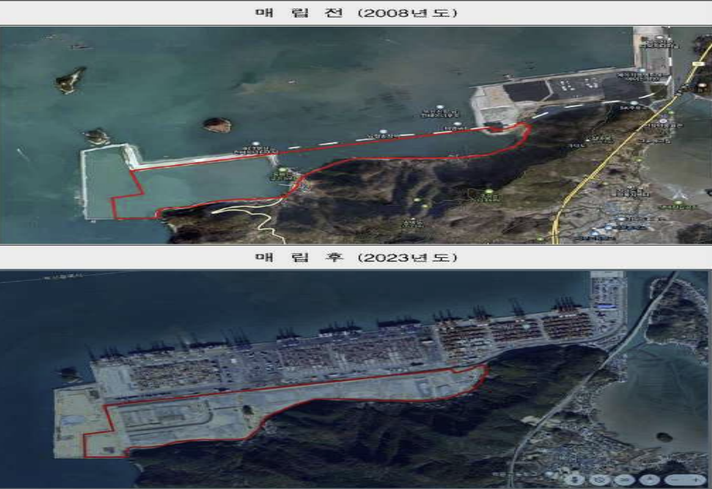
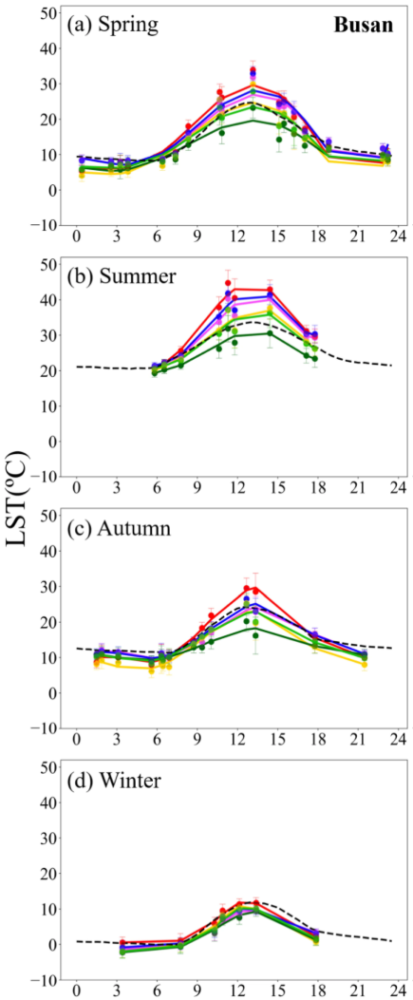
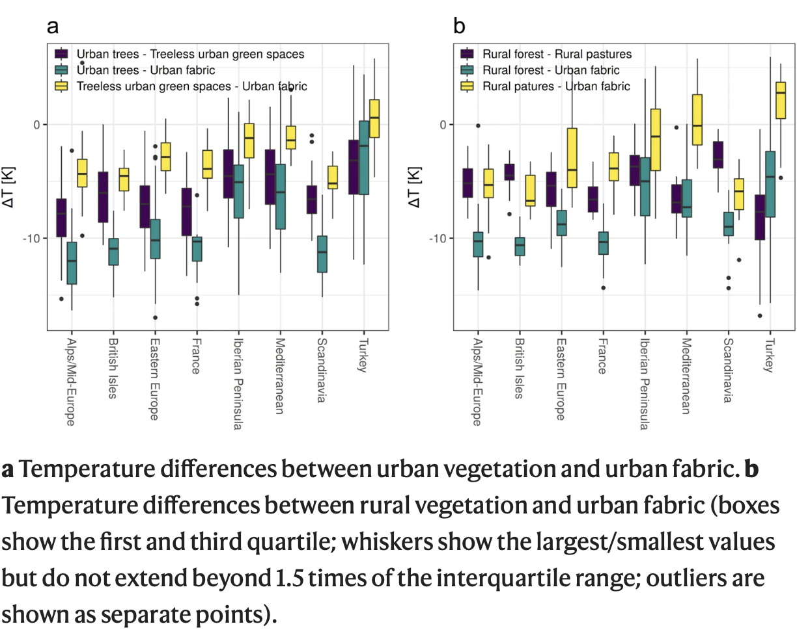
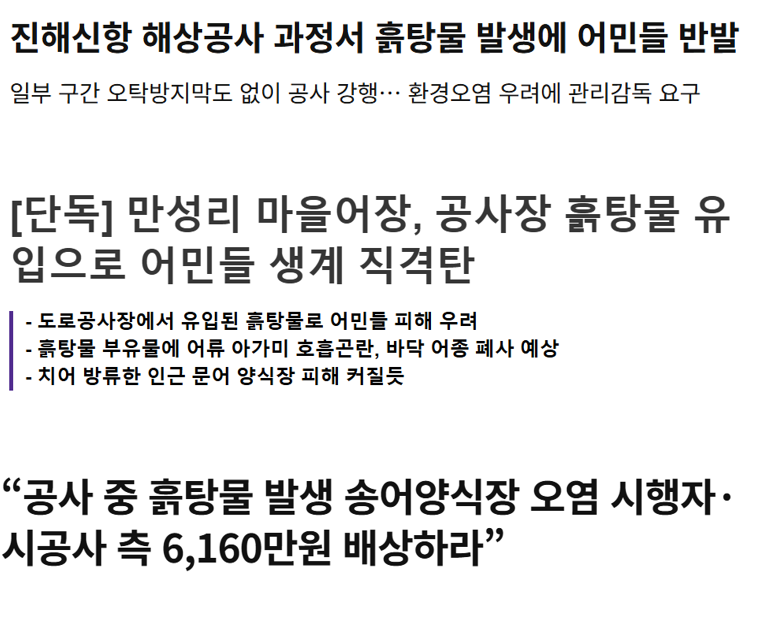

> **교육용 합성자료에 기반한 학술 보고서 예시.** 본문은 실제 도시·Landsat 관측 결과를 제시하지 않는다. 기본 탐색용 36개 표본과 세부목적 분석용 384행은 서로 다른 합성자료이다. 연구 질문을 학술적 목적으로 구체화하는 과정을 보여주기 위해 일상적 질문과 정식 목적 진술을 함께 제시하였다.

### 초록 {#abstract}


**주제어:** NDVI, 지표면 온도, 환경조건 보정, 계절 교호작용, 공간 블록 교차검증, 합성자료

## 1. 연구 배경 {#background}

### 1.1 부산신항 개발과 매립에 따른 공간적 변화

부산신항은 동북아시아 물류 중심 항만의 구축을 목적으로 추진된 대규모 항만 개발사업으로, 부산광역시 강서구 가덕도 북안과 경상남도 창원시 진해구 용원동·웅동·제덕만 일원에 걸쳐 조성되고 있다. 부산광역시의 항만 개발 현황에 따르면 부산신항 개발은 1995년부터 시작되었으며, 부두와 항만 배후단지, 도로 및 철도 등 대규모 기반시설의 확충이 단계적으로 진행되어 왔다[[1]](https://www.busan.go.kr/depart/ocean).

부산신항 개발은 기존 해안지역에 항만시설과 물류단지를 조성하기 위한 매립 및 부지 확장을 포함한다. 이러한 과정에서 기존 해안과 해수면의 경계가 변화하고, 과거 해역이었던 공간이 항만시설과 육상 기반시설로 전환되었다. 부산신항은 장기간에 걸쳐 여러 구간에서 개발이 진행된 지역이므로, 개발 시기에 따라 해안선의 형태와 육상·해양 공간의 구성이 달라졌다는 특징을 가진다.

이처럼 대규모 매립이 이루어진 지역에서 해안선은 단순한 지리적 경계가 아니라 개발에 따른 공간 구조의 변화를 보여주는 중요한 지표이다. 따라서 부산신항의 개발 과정을 이해하기 위해서는 매립에 따른 해안선의 변화와 그에 따른 주변 공간의 변화를 함께 살펴볼 필요가 있다.



그림 1.1. 부산신항 매립 전과 후 사진[[2]](https://www.mois.go.kr/cmm/fms/FileDown.do?atchFileId=FILE_00130465XriwqSQ&fileSn=0)

### 1.2 매립에 따른 해안선 및 연안 환경 변화의 중요성

연안지역은 육지와 바다가 만나는 공간으로, 해안선의 형태와 수심, 조류 및 퇴적물의 이동 등 여러 자연적 요인이 상호작용하는 환경이다. 이러한 지역에서 대규모 매립과 해안 구조물의 설치가 이루어지면 기존 해안의 형태뿐만 아니라 주변 해역의 물리적 환경에도 변화가 나타날 가능성이 있다.

특히 방파제와 호안 등 해안 구조물의 조성은 파랑과 조류의 흐름에 영향을 줄 수 있으며, 해저 지형과 퇴적물의 이동에도 영향을 미칠 수 있다. 따라서 매립에 따른 해안선 변화는 단순한 육지 면적의 증가를 의미하는 것이 아니라, 연안 공간의 물리적 구조가 변화하는 과정으로 이해할 필요가 있다.

실제로 새만금 방조제 건설에 따른 연안 환경 변화를 분석한 연구에서는 Landsat 시계열을 활용하여 공사 진행 시기에 따른 해수 내 부유물질 농도의 변화를 확인하였다[[3]](https://www.sciencedirect.com/science/article/abs/pii/S0025326X11005650). 이는 대규모 연안 개발이 이루어지는 과정에서 해안선의 변화와 주변 해역의 환경적 특성을 함께 살펴보는 것이 중요하다는 점을 보여준다.

### 1.3 항만 개발지역 인접 내륙의 지표면 온도 문제

항만 및 산업지역은 컨테이너 야적장, 물류시설, 도로 등 다양한 인공시설이 밀집한 공간으로, 일반적인 주거지역이나 자연지역과는 다른 토지 이용 특성을 가진다. 특히 대규모 인공 지표면이 형성된 지역에서는 태양복사에너지의 흡수와 방출 특성이 달라지면서 주변 지역과 구분되는 지표면 온도(Land Surface Temperature, LST) 차이가 나타난다.

부산과 대구를 대상으로 위성 기반 지표면 온도 자료를 활용하여 도시열섬의 시공간적 특성을 분석한 연구에서는 부산의 여름철 최대 지표면 도시열섬 강도가 약 7℃로 나타났으며, 부산의 산업지역에서는 최대 43℃의 지표면 온도가 관측되었다[[4]](https://www.mdpi.com/2072-4292/17/23/3815). 또한 산업지역과 상업지역, 주거지역 사이에서 열환경의 차이가 나타났으며, 토지 이용의 밀도와 공간적 구성에 따라 온도 분포가 달라지는 특성이 확인되었다.


그림 1.2. 부산 지역 2020년~2023년 LST 그래프 (빨강: 공업지역, 파랑: 상업지역, 노랑: 농업지역, 초록: 산림지역, 연두: 초지, 분홍: 주거지역)[4]

이러한 지표면 온도의 상승은 단순한 미기후 변화를 넘어 인접 지역 주민의 건강과 직결되는 사회적 문제로 이어질 수 있다. 위성 관측 지표면 온도와 폭염 피해의 상관관계를 분석한 연구에 따르면, 2003년 파리 폭염 당시 지표면 온도가 높게 나타난 지역에 거주하는 고령층의 사망 위험이 주변 지역에 비해 약 2.2배 높게 나타났다[5]. 이처럼 높은 지표면 온도는 폭염 시 온열질환 발생 및 건강 취약계층의 피해를 가중하는 주요 요인으로 작용한다.

부산신항 역시 대규모 항만시설과 물류단지가 집적된 지역이라는 점에서 인접한 주거 및 내륙지역의 지표면 온도 변화를 면밀히 살펴볼 필요가 있다. 항만·물류 시설과 인접 내륙지역은 토지 이용과 피복 특성이 상이하므로, 매립과 개발에 따른 지역별 지표면 온도 분포의 차이를 파악하는 것은 연안 도시의 환경적·사회적 영향을 이해하는 데 중요한 의미를 가진다.


그림 1.3. 유럽 지역별 수목 지역·수목이 없는 도시 녹지·시가화 지역 간 여름철 지표면 온도 차이.[6]

### 1.4 매립 및 항만 개발 주변 해역의 탁도 문제

연안 해역의 탁도는 물속에 존재하는 부유물질과 입자성 물질 등에 의해 물의 투명도가 감소하는 정도를 나타내는 환경적 특성이다. 부유물질은 해수의 빛 투과율을 저하시켜 저서 생태계에 영향을 미치며, 연안 해양환경의 상태를 이해하는 데 중요한 지표로 활용된다.

대규모 매립과 항만 건설 과정에서는 준설, 토사 이동, 해저 지형 변화 등으로 인해 해역 내 부유물질의 분포가 달라질 가능성이 있다. 또한 조류와 해류의 흐름, 강우 및 하천 유입 등 자연적인 요인도 해역의 탁도에 영향을 줄 수 있으므로, 연안 해역의 탁도는 다양한 요인이 복합적으로 작용하는 환경적 지표로 이해해야 한다.

부산 연안 해역의 투명도와 부유물질 분포를 분석한 선행연구에서는 2011년부터 2022년까지의 관측자료를 바탕으로 해역별 부유물질 농도와 투명도의 차이를 확인한 연구 사례가 있다. 특히 부산신항 내측 해역에서는 저층 부유물질 농도가 최대 92.6mg/L로 관측되었으며, 부산 연안 해역이 위치에 따라 서로 다른 부유물질 분포 특성을 보이는 것으로 나타났다[7]. 또한 부산신항 준설과 관련된 해양환경 모니터링 연구에서도 신항 및 진해만 주변의 관측 지점을 대상으로 부유물질 농도의 시기별 변화와 공간적 분포가 분석되었다[[8]](https://www.mdpi.com/2073-4441/17/6/852).



그림 1.4. 진해신항 부유사 피해.[9]

이러한 부유물질 농도 상승과 탁도 변화는 해양생태계 교란뿐만 아니라 지역 어업 환경에도 영향을 미칠 수 있다. 부산신항과 인접한 진해만 일대는 굴, 피조개 등 패류 양식과 연안 어업이 활발히 이루어지는 해역으로, 부유사의 확산과 침적은 양식 생물의 생육 저하 등 어업 활동에 잠재적인 피해를 초래할 우려가 있다. 따라서 부산신항 개발에 따른 주변 해역의 탁도 변화를 시공간적으로 관측하는 것은 연안 환경 보전과 지역 수산업 보호 측면에서 중요한 과제이다.

### 1.5 부산신항 주변 환경 변화에 대한 종합적 관심의 필요성

부산신항은 장기간에 걸쳐 대규모 매립과 항만시설 및 배후단지 개발이 이루어진 지역으로, 개발 과정에서 육상과 해양의 공간적 구성이 변화해 왔다. 이러한 공간적 변화는 해안선의 형태뿐만 아니라 인접 내륙의 열환경과 주변 해역의 환경적 특성을 함께 살펴볼 필요성을 제기한다.

기존 연구에서는 부산의 산업지역을 중심으로 지표면 온도의 공간적 차이가 확인되었으며, 부산신항 주변 해역에서도 부유물질 농도와 투명도의 지역별 차이가 관측된 바 있다. 이러한 환경적 특성은 각각의 공간과 시기에 따라 다르게 나타날 수 있으므로, 특정 지역의 개발 과정을 이해하기 위해서는 육상과 해양을 구분하여 환경 지표의 변화를 살펴볼 필요가 있다.

특히 부산신항과 같이 매립이 단계적으로 진행된 지역은 해안선의 변화와 인접 내륙 및 주변 해역의 환경적 특성을 함께 이해할 수 있는 중요한 사례이다. 따라서 부산신항의 매립 구간을 중심으로 해안선 변화와 인접 내륙의 지표면 온도, 주변 해역의 탁도 지표가 나타내는 시기별·공간적 특성에 집중한다. 이에 본 연구는 해안선, 지표면 온도, 탁도 지표를 각각 측정하되, 이를 매립 단계라는 같은 시간축에 놓고 비교하고자 한다.


**참고문헌**
1. 부산광역시. 부산신항 개발현황. 부산광역시 해양농수산국. https://www.busan.go.kr/depart/ocean
2. 부산신항 매립 전과 후 사진 https://www.mois.go.kr/cmm/fms/FileDown.do?atchFileId=FILE_00130465XriwqSQ&fileSn=0
3. Ryu, J. H., Won, J. S., & Min, K. D. (2007). Monitoring of suspended sediment variation using Landsat and MODIS in the Saemangeum coastal area of Korea. Continental Shelf Research, 27(17), 2224–2239.
4. Jeon, G.-S.; Kim, W. Resolving Surface Heat Island Effects in Fine-Scale Spatio-Temporal Domains for the Two Warmest Metropolitan Cities of Korea. Remote Sens. 2025, 17, 3815. https://doi.org/10.3390/rs17233815
5. Laaidi K, Zeghnoun A, Dousset B, Bretin P, Vandentorren S, Giraudet E, Beaudeau P. The impact of heat islands on mortality in Paris during the August 2003 heat wave. Environ Health Perspect. 2012 Feb;120(2):254-9. doi: 10.1289/ehp.1103532. Epub 2011 Sep 1. PMID: 21885383; PMCID: PMC3279432.
6. Schwaab et al. (2021), Figure 3a 발췌.
7. 이상협(Sang-Hyub Lee), 장성철(Sung-Chul Jang), and 윤한삼(Han-Sam Yoon). "부산 연안 해수의 투명도와 부유물질의 공간 분포 특성에 관한 연구." 한국해양환경·에너지학회지 25.4 (2022): 171-182.
8. Kim, J.; Ghosh, A.; Paul, T.; Yee, J.-J.; Park, S. Assessing the Environmental Impact of Busan New Port Construction in Korea: A Comprehensive Analysis of Water Quality Changes and Suspended Solids in Jinhae Bay. Water 2025, 17, 852. https://doi.org/10.3390/w17060852
9. "진해신항 해상공사 과정서 흙탕물 발생에 어민들 반발", 동행미디어시대, 2026. 03. 17., 황철성 기자

## 2. 연구 질문 {#question}

연구 배경의 분석 문제를 다음 세 질문으로 구체화하였다. 일상적 질문은 문제의식을 표현하고, 학술적 연구 질문은 비교 대상과 조건을 명시한다. 질문 1–3은 다음 절의 세부목적 1–3에 각각 대응한다.

### 2.1 연구 질문 1

> **일상적 질문:** “부산신항에서는 매립이 진행되면서 어느 시기에 어디에서 얼마나 넓은 바다가 육지로 바뀌었을까?”

**학술적 연구 질문.**  2000~2023년, Landsat 위성영상에서 확인되는 부산신항의 매립 구간은 관측 시기별로 어디에 분포하며, 각 단계에서 새로 조성된 매립지의 면적은 얼마인가?

### 2.2 연구 질문 2

> **일상적 질문:** “부산신항 앞바다가 매립되는 동안 인접 내륙인 용원동의 여름철 지표면 온도는 어떻게 달라졌을까? 변화가 유독 큰 때나 곳이 있었다면 그 이유는 무엇일까?”

**학술적 연구 질문.** 2000~2023년 여름철(6~8월), 용원동 기존 내륙의 지표면 온도(LST)는 시기와 위치에 따라 어떻게 변했는가? 주변 지역과 다른 변화가 나타났다면, 그 시기는 부산신항의 매립이나 용원동 내부의 토지피복 변화 시기와 어떤 관계를 보이는가?

### 2.3 연구 질문 3

> **일상적 질문:** “부산신항 주변 바다에서 물이 탁한 곳은 항만 안쪽뿐일까, 아니면 신항에서 멀리 떨어진 바다까지 퍼져 있을까? 매립 진행 상황에 따라 이 분포가 달라졌을까?”

**학술적 연구 질문.** 2000~2023년 여름철(6~9월) Landsat 위성영상으로 관측한 부산신항 주변 해역에서, 항내와 항외(매립지 경계로 부터 6km 이내)의 탁도지수(NDTI)는 어떻게 분포하며, 거리에 따른 탁도지수는 매립 진행 시기에 따라 어떻게 달라졌는가?

## 3. 연구 목적 {#objectives}

### 3.1 전체 연구목적

본 연구는 2000~2023년 Landsat 위성영상을 활용하여 부산신항의 매립 과정과 주변 육상·해역의 변화를 살펴보는 것을 목적으로 한다. 먼저 매년 6~8월의 수륙 경계를 비교하여 새로 육지로 전환된 구간과 면적을 산출한다. 다음으로 용원동 기존 내륙의 여름철 지표면 온도가 언제, 어디에서 달라졌는지 파악하고, 주변 비교지역의 온도 및 매립·토지피복 변화 이력과 대조한다. 마지막으로 여름철 항내의 탁도지수를 산출하고, 높은 지숫값이 항만 입구에서 항외의 어느 범위까지 이어져 관측되는지 확인한다.

### 3.2 세부목적 1 · 부산신항의 시기별 해안선 변화 파악 및 신규 매립면적 정량화

**연구 질문 1의 목적화.** 2000~2023년 Landsat 위성영상에서 추출한 부산신항의 시기별 해안선을 중첩하여, 각 관측 시점 사이에 수역에서 육지로 전환된 매립 구간을 확인하고 그 면적을 산출한다. 이를 통해 어느 **시기에 어느 구간에서 매립이 집중되었는지 밝힌다.**

**필요성 및 평가 지표.** 부산신항은 구간마다 매립 시기가 달라 누적 면적만으로는 어느 시기에 어디에서 수역이 육지로 전환됐는지 파악하기 어렵다. 이에 시기별 신규 매립 구간을 지도에 표시하고, 신규 매립면적과 누적 매립면적을 km²로 산출한다. 독립 기준 해안선을 확보한 구간에서는 기준 해안선에 수직인 측선을 따라 위치 차이를 측정하고 RMSE(m)로 평가한다.


### 3.3 세부목적 2 · 부산신항 매립 과정에서 나타난 인접 내륙(용원동)의 여름철 지표면 온도 변화

**연구 질문 2의 목적화.** 2000~2023년 매년 6~8월의 Landsat 위성영상을 활용하여, 2000년에 이미 육지였던 용원동 내륙에서 지표면 온도가 어느 시기와 구역에서 변화가 두드러졌는지 파악한다. 세부목적 1에서 확인한 부산신항 매립 구간 중 용원동에 인접한 구간의 연도별 확장 과정을 추출하고, 내륙의 온도 변화 시기와 대조한다. 온도 상승이 두드러진 구역은 주변의 유사한 비교지역 및 같은 위치의 과거 항공사진과 비교하여 변화 양상을 구체적으로 살펴본다.

**필요성 및 평가 지표.** 용원동의 어느 구역이 특정 여름에 높은 온도를 보였다는 사실만으로는 그곳이 이전보다 따뜻해졌는지 알기 어렵다. 또한 용원동의 온도가 상승했더라도 주변 지역이 비슷하게 상승했다면 해당 시기의 광역적인 기상·기후 변화가 함께 반영됐을 수 있다. 이에 주요 평가 지표로 **용원동 각 구역의 기간 간 LST 변화량(℃)**과 **비교지역 대비 상대적 LST 변화량(℃)**을 사용한다. 온도 상승 시점에 용원동 내부에서도 건축·포장 등 피복 변화가 있었는지 확인하고, 피복이 유지된 구역에서도 상대적인 상승이 관측되는지 검토한다.

### 3.4 세부목적 3 · 부산신항 항내와 항외 해역의 연도별 여름철 탁도지수 분포 파악

**연구 질문 3의 목적화.** 2000~2023년 여름철(6~9월) Landsat 위성영상을 활용하여, 세부목적 1에서 확인한 연도별 매립 과정과 함께 항내와 항외(매립지 경계로부터 6 km 이내)의 탁도지수(NDTI) 분포와 변화를 살펴본다. 먼저 매립이 진행되는 동안 항내의 NDTI가 항외와 비교하여 어느 정도였는지 파악한다.
항외에서 매립지 경계로부터 멀어질수록 NDTI가 어떻게 달라지는지 살펴본다. 이어서 세부목적 1에서 확인한 매립 진행 시기와 대조하여, 항내와 항외의 NDTI 수준 및 거리에 따른 분포가 시기에 따라 어떻게 달라졌는지 확인한다.

**필요성 및 평가 지표.** 항내의 NDTI와 항외 NDTI의 공간적 분포는 서로 다른 정보다. 항내의 NDTI 값만으로 탁함의 정도는 알 수 없다. 항외 전체를 하나의 값으로 요약하면 신항과 인접한 해역과 먼 해역의 차이가 드러나지 않는다. 또, 특정 연도의 결과만으로는 매립 진행과의 관계를 파악하기 어렵다.
이에 탁함의 정도는 연도별 항내와 항외의 대표 NDTI를 비교하여 평가하고, 공간적 분포는 매립지 경계로부터의 거리에 따른 항외의 대표 NDTI로 파악한다. 시기에 따른 변화는 세부목적 1의 매립 진행 시기와 대조한 연도별 NDTI 추이로 평가한다. 이렇게 파악한 결과는 위성영상에서 관측된 상대적 탁도지수의 분포로 해석하며, 그 원인을 매립으로 단정하지 않는다.


## 4. 재료 {#materials}

### 4.1 연구 대상과 관측 기간


**그림 4.1.1** 부산신항 인접 양식장 위치


**그림 4.1.2** 부산신항과 용원동, 경화동 위치


**그림 4.1.3** 부산신항 경계로부터 6km 범위 

연구 기간은 2000~2023년이다. 세부목적 1은 부산신항 전체 매립사업 구역과 그 주변 수역을 대상으로 하며, 매년 6~8월의 위성영상에서 같은 위치의 수륙 경계를 비교한다. 예비 분석의 영상 검색 범위는 동경 128.73°~128.88°, 북위 35.025°~35.135°이다. 이 범위는 영상을 검색하기 위해 설정한 사각형이므로, 부산신항 전체의 신규 매립면적을 산정할 때에는 공식 사업구역도와 대조하여 최종 집계 범위를 확정한다. 2000년에 이미 육지였던 구역은 이후의 신규 매립면적 집계에서 제외한다.

세부목적 2의 대상은 창원시 진해구 용원동 법정동 경계 안에서 2000년 당시 육지로 확인된 구역이다. 기존 육지의 범위를 판별할 때에는 유효 관측일을 충분히 확보하기 위해 2000년 4~10월의 광학영상을 사용한다. 온도 분석에는 2000~2023년 매년 6월 1일~8월 31일의 영상을 사용하며, 전 기간에 같은 내륙 범위를 적용하여 각 위치의 여름철 지표면 온도 변화를 추적한다.

세부목적 3의 대상은 부산신항 항내와 항만 입구를 거쳐 바깥쪽으로 이어지는 주변 해역(0~6km)이다. 2000~2023년 매년 6~9월의 영상에서 관측 당시 수역으로 확인되는 화소를 대상으로, 항내와 항외의 여름철 탁도지수 분포를 파악한다.

### 4.2 Landsat 지표면 반사도와 지표면 온도

미국 지질조사국(USGS)의 Landsat Collection 2 Tier 1 Level-2 자료를 Google Earth Engine에서 조회한다. 연도별 검색 대상은 2000~2011년 Landsat 5·7, 2012년 Landsat 7, 2013~2020년 Landsat 8, 2021~2024년 Landsat 8·9이다. 실제 사용 센서와 촬영일은 각 세부목적의 관측 기간과 영상의 유효 관측 범위에 따라 결정되므로, 분석에 포함한 영상의 식별자와 촬영일을 기록한다. 위치·거리·면적을 계산할 때에는 UTM 52N 좌표계(EPSG:32652)를 사용한다.

수륙 경계 추출에는 30 m 지표면 반사도 자료를 사용한다. 녹색광(Green)과 근적외선(NIR) 밴드는 Landsat 5·7에서 각각 SR_B2와 SR_B4, Landsat 8·9에서 각각 SR_B3와 SR_B5이다. 각 밴드의 저장값(DN)을 지표면 반사도(ρ)로 환산한 뒤, 녹색광과 근적외선 반사도의 차이를 이용하여 정규수역지수(NDWI)를 계산한다. 이 지수를 바탕으로 연도별 수역과 육지를 구분하고 수륙 경계를 추출한다.


### 4.3 인접 내륙(용원동)의 여름철 지표면 온도(LST) 분석 자료

용원동 기존 내륙의 여름철 지표면 온도(LST)를 구하기 위해 지표면 온도 밴드가 포함된 Landsat L2SP 영상을 사용한다. Landsat 5·7에서는 ST_B6, Landsat 8·9에서는 ST_B10의 저장값을 섭씨온도(℃)로 환산한다. 센서별 열영상의 원래 관측 해상도가 서로 다른 점을 고려하여 온도는 120 m 공통 격자로 집계한다. 각 격자의 LST는 위성이 통과한 시점에 관측한 지표면의 온도를 나타낸다.


여기서 $DN_{ST}$는 지표면 온도 밴드에 저장된 화소값이다. 온도 자료에는 촬영일과 유효 관측 범위를 함께 기록한다. 연도마다 구름이 적었던 달이나 관측 가능한 위치가 달라질 수 있으므로, 6월·7월·8월의 관측값을 구분하여 보관한다.

온도 변화의 배경을 살펴보기 위해 세부목적 1에서 파악한 용원동 앞 매립 구간의 시기별 경계와 면적을 활용한다. 용원동 내부의 변화는 촬영일이 확인되는 항공사진이나 토지피복자료를 이용하여 같은 위치에 도로·건축물·포장면 등이 언제 형성됐는지 확인한다. 주변 지역과의 비교를 위한 대조군으로는 창원시 진해구 경화동 기존 시가지를 선정하였다. 경화동은 연구 초기의 도시화 정도와 해안 인접성 등 지리적 여건이 용원동과 유사하면서도, 2000~2023년 연구 기간 동안 인접 해역에 대규모 매립 공사가 없었던 기성 시가지이므로 광역적 기상 변동을 통제하는 비교지역으로 적합하다.

### 4.4 부산신항 주변 해역의 탁도지수(NDTI) 산출 자료

부산신항 주변 해역의 탁수 분포를 파악하기 위해 2000년부터 2023년까지 매년 6월 부터 9월까지 촬영된 Landsat 영상의 30 m 지표면 반사도 자료를 사용한다. 적색과 녹색 밴드는 Landsat 5·7에서 각각 SR_B3과 SR_B2, Landsat 8·9에서 각각 SR_B4와 SR_B3이다. 각 픽셀의 적색과 녹색 밴드의 반사도를 구한 뒤, 아래 그림의 산출식에 따라 수역으로 판별된 화소의 정규화 차이 탁도지수(NDTI)를 계산한다. 각 화소에서 해당 연도 6월 부터 9월까지에 유효하게 관측된 NDTI의 값을 구해 연도별 탁수 분포 지도를 작성한다.


### 4.5 자료의 한계

위성영상에서 추출한 수륙 경계는 촬영 당시의 수면 상태를 반영한다. 갯벌처럼 조위에 따라 노출 범위가 달라지는 곳에서는 한 시점의 수역 감소가 매립처럼 보일 수 있으므로, 이후 영상에서 육지가 유지되는지와 자연색 영상에서 부지 조성 형태가 확인되는지를 함께 살펴볼 필요가 있다. 또한 본 연구에서 산출하는 신규 매립면적은 2000년 이후 관측 시점 사이에 확인되는 변화량이므로, 사업 시작 이후의 전체 누적 매립면적과는 범위가 다르다.

용원동의 지표면 온도 자료는 30 m 격자로 제공되지만, 열적외선 센서의 원래 관측 해상도는 이보다 거칠다. 따라서 시기별 온도 변화는 120 m 공통 격자와 인접 격자가 이루는 구역 단위로 해석한다. 구름으로 인해 연도별 유효 촬영일과 관측 범위가 달라질 수 있으며, 용원동 앞 매립과 내부 개발이 비슷한 시기에 진행된 경우에는 위성영상만으로 두 요인의 기여를 구분하기 어렵다.


## 5. 방법 {#method}

### 5.1 영상 전처리와 유효 관측일 산정

Google Colab에서 연구 범위와 기간으로 영상을 검색한 뒤, QA_PIXEL과 QA_RADSAT 품질 밴드를 이용해 채움값, 구름, 구름 그림자, 눈 및 포화 화소 등을 제외한다. 같은 날짜에 두 영상이 겹쳐도 유효 관측일은 하루로 계산한다.


### 5.2 세부목적 1의 분석 · 부산신항의 시기별 신규 매립면적 산정

**수륙 경계 추출.** 부산신항 전체 매립사업 구간을 포함하도록 분석 범위를 고정하고, 2000~2023년 매년 6~8월 Landsat 영상에서 정규수역지수(NDWI)를 계산한다. NDWI는 녹색광과 근적외선 반사도를 이용하여 (Green − NIR) / (Green + NIR)로 산출한다. 구름과 구름 그림자 등에 가려진 화소를 제외하고, 같은 날 겹쳐 촬영된 영상은 하나의 관측일로 통합한다. 각 화소에서 6~8월 중 서로 다른 유효 관측일 2일 이상이면 일별 NDWI의 중앙값을 해당 연도의 대표값으로 사용한다. 예비 분석에서는 NDWI가 0을 초과하면 수역, 0 이하면 육지로 분류한다. 대표 연도의 자연색 영상과 대조하고 임계값을 −0.05, 0, +0.05로 바꾸었을 때 경계가 얼마나 달라지는지 확인한 뒤, 최종 선정한 기준을 모든 연도에 동일하게 적용한다.

**신규 매립 구간 판별.** 같은 위치에서 앞선 유효 연도에 수역이었고 이후 처음 육지로 분류된 화소를 추출한다. 다음 유효 연도에도 육지가 유지되면 지속적인 육지 전환 후보로 분류하고, 자연색 영상에서 호안이나 부두가 조성된 형태와 일치하는지 확인한다. 조위에 따라 갯벌이 일시적으로 드러난 곳이나 구름 때문에 후속 확인이 어려운 곳은 미확정 구간으로 남긴다. 같은 이유로 2023년에 처음 육지로 나타난 화소는 후속 관측이 확보될 때까지 잠정 후보로 표시한다.

**면적 산정 및 결과 제시.** 신규 매립으로 확인된 30 m × 30 m 화소 한 개의 면적은 0.0009 km²이다. 이를 관측 기간별로 합산하여 신규 매립면적을 구하고, 같은 위치가 여러 해에 중복 합산되지 않도록 한다. 예를 들어 2010년에 수역, 2011년에 결측, 2012년에 육지로 관측되고 이후에도 육지가 유지됐다면, 해당 면적은 ‘2010~2012년 사이 전환 구간’으로 기록한다. 연도별 그래프에서는 2012년을 최초 육지 관측연도로 표시하고, 관측 공백을 거쳐 확인된 면적을 구분한다. 최종적으로 자연색 영상 위에 시기별 해안선과 신규 매립 구간을 표시하고, 신규 면적과 누적 면적을 그래프로 제시한다. 해안선의 위치 정확도는 독립 기준자료를 확보한 구간에서 수직 측선별 이격거리의 RMSE(m)로 평가한다.

### 5.3 세부목적 2의 분석 · 인접 내륙(용원동)의 여름철 지표면 온도의 시기별/공간적 변화

**여름철 대표 온도 산출.** 창원시 진해구 용원동 경계 안에서 2000년 당시 육지로 관측된 구역을 고정하여, 이후 바다에서 육지로 바뀐 매립지가 온도 비교 대상에 들어가는 것을 방지한다. 매년 6~8월 영상에서 구름·구름 그림자·포화 화소와 촬영 당시 수역으로 판별된 위치를 제외한다. 같은 날 여러 영상이 겹치면 하나의 관측일로 통합한다. 6월 영상이 많은 해와 8월 영상이 많은 해를 그대로 비교하면 촬영 월의 차이가 연도별 온도 차이에 반영될 수 있으므로, 각 격자에서 먼저 6월·7월·8월의 LST 중앙값을 각각 구한다. 세 달의 중앙값에 같은 비중을 주어 해당 연도의 여름 대표 LST를 산출한다.


여기서 $M_{i,y,m}$은 격자 $i$에서 $y$년 $m$월에 유효하게 관측된 일별 LST의 중앙값이다. 월별 대표값은 서로 다른 유효 관측일이 2일 이상일 때 산출하는 것을 예비 기준으로 한다. 한 달이라도 기준을 충족하지 못하면 그 격자의 여름 대표값은 결측으로 남긴다. 관측 가능한 달의 값은 같은 달끼리 비교하는 보조 분석에 활용하고, 연도별 지도에는 유효 관측 범위를 함께 표시한다.

**온도 변화가 두드러진 시기와 구역 탐색.** 특정 연도를 매립 영향의 시작점으로 미리 정하지 않고, 용원동 내륙의 같은 격자에서 앞뒤 기간의 여름 대표 LST가 얼마나 달라졌는지 비교한다. 한 해의 유난히 덥거나 서늘한 날씨에 결과가 좌우되는 것을 줄이기 위해, 예비 분석에서는 기준연도 직전 3개 여름과 기준연도부터 시작되는 3개 여름을 비교한다. 예를 들어 2014년을 기준으로 하면 2011~2013년과 2014~2016년을 비교한다. 동일한 계산을 앞뒤 3년을 확보할 수 있는 각 기준연도에 적용한다.


온도 변화량 $\Delta D$가 양수이면 같은 격자의 후기 지표면이 전기보다 따뜻했고, 음수이면 더 서늘했음을 뜻한다. 각 기간에 유효한 여름이 2개 이상인 격자에서 변화량을 계산한다. 결과는 0℃를 중심으로 상승과 하강을 함께 나타내는 지도로 제시하고, 인접한 여러 격자에서 큰 변화가 관측된 시기와 구역을 찾는다. 연속된 기준연도는 관측 기간이 일부 겹치므로, 지도에서 같은 변화가 여러 번 나타나더라도 이를 별개의 사건으로 세지 않는다.

**주변 지역 및 개발 이력과의 비교.**  변화가 두드러진 구역을 찾으면, 그 변화가 용원동에 국한됐는지 확인하기 위해 같은 촬영일의 대조군(경화동) 시가지 LST와 대조한다. 두 구역 모두에서 유효 관측 면적이 충분한 날짜만 사용하며, 예비 기준은 각 구역 면적의 70% 이상으로 한다. 날짜별로 용원동 해당 구역의 중앙 LST에서 비교지역의 중앙 LST를 뺀 뒤, 앞 절과 같이 월별·여름별로 요약하여 앞뒤 기간의 차이를 구한다.


$\Delta D$가 양수이면 전기에 비해 후기에 용원동 해당 구역이 비교지역보다 상대적으로 더 따뜻해졌음을 뜻한다. 마지막으로 용원동의 온도 변화 시기, 용원동 앞 매립지의 확장 시기, 용원동 내부의 건축·포장 등 피복 변화 시기를 같은 시간축에 놓고 비교한다. 두 지역에서 비슷한 변화가 관측됐는지, 용원동 내부 개발이 진행된 구역에 변화가 집중됐는지, 피복이 유지된 구역에서도 매립 시기와 맞물린 변화가 나타났는지 살펴본다. 결과에는 비교에 사용된 촬영일 수와 유효 면적 비율을 함께 제시한다. 여러 변화가 같은 시기에 겹친 구역은 원인을 구분하기 어려운 사례로 기록한다.

### 5.4 세부목적 3의 분석 · 여름철 항내·항외 탁도지수 분포 파악

**여름철 대표값 산출.** 각 화소에서 6~9월 동안 유효하게 관측된 NDTI 값들의 중앙값을 그해의 대표값으로 사용 한다. 중앙값을 택한 이유는 다음과 같다.첫째, 6월 말~7월 장마철에는 품질 밴드가 걸러내지 못한 구름 가장자리, 얇은 연무, 구름 그림자가 남아 비정상적인 값을 만든다. 둘째, 태풍이나 집중호우 뒤의 재부유, 낙동강 방류처럼 일시적으로 탁도가 크게 높아지는 사건은 소수의 비정상적으로 높은 탁도 관측값을 발생시키며, 이러한 값은 평균을 실제 평상시 상태보다 높게 끌어올린다. 본 연구는 연도별 평상시 탁도 상태를 비교하는 것이 목적이므로, 이러한 일시적 사건의 영향을 줄일 수 있는 중앙값이 적합하다.


**매립지 경계와 비교 구역 설정.** 매립지는 세부목적 1에서 해당 관측 시점까지 형성이 확인된 구역까지로 정한다. 신항 영역에서 매립지를 뺀 수역을 신항 내부 해역, 신항 영역 경계부터 0~6 km를 주변 해역으로 정의한다. 

**구역별 통계와 비교.** 연도마다 신항 내부 해역, 주변 0~6 km 해역에 대해 30 m 수역 화소의 평균, 중앙값, 표준편차, 화소 수를 계산한다. 구역의 대표 NDTI는 화소 값의 중앙값으로 한다. 결과는 세 가지 방식으로 비교한다. 

첫째, 신항 내부 해역과 주변 0~6 km 해역의 대표 NDTI를 연도별 그래프로 나타내어 두 구역의 차이와 시기별 변화를 비교한다. 

둘째, 거리 대별 대표 NDTI를 연도-거리 표로 나타내어 매립지에서 멀어질수록 탁도가 낮아지는 경향이 있는지, 그 경향이 시기에 따라 달라지는지 확인한다. 

셋째, 거리대별 대표 NDTI를 연도별 그래프로 나타내고 세부목적 1에서 확인한 매립 진행 시기를 함께 표시하여, 매립 진행 시기에 따라 NDTI 추이가 어떻게 달라졌는지 대조한다.


**지도 표현.** 연도별 NDTI 지도는 24개 연도에 같은 색 범위를 적용하여 연도 간 색을 직접 비교할 수 있게 한다. 색 범위는 연도마다 분석 범위 안 수역 화소 값의 2백분위수와 98백분위수를 구하고, 25개 연도 값의 중앙값을 최솟값과 최댓값으로 정한다. 색상은 파랑(맑음)에서 빨강(탁함)으로 이어지는 발산형 색표(RdYlBu)를 사용한다. 지도에는 매립지 경계를 검은 선으로, 신항 영역에서 0~6 km 떨어진 등거리선을 흰 선으로 표시한다. 자연색 영상을 배경으로 깔아 매립지 경계가 실제 부두 형태와 일치 하는지 눈으로 확인한다 


### 5.5 관측자료의 오차 점검 및 재현성 확보

**결측 및 오분류 점검.** 구름이나 구름 그림자로 가려진 화소와 결측 화소는 분석에서 제외한다. 매립 여부가 불분명한 곳은 이후 영상에서도 육지로 나타나는지 확인해 갯벌의 일시적 노출과 구분한다. 지표면 온도는 같은 촬영일에 두 비교 구역이 모두 관측된 경우에만 비교한다. 탁도지수 지도에는 결측 수역을 별도로 표시하고, 항만 입구가 가려진 경우에는 높은 지수가 항외까지 이어지는지 판단을 보류한다.


**재현성 확보.** 사용한 Landsat 영상의 제품 식별자와 촬영일, 분석 구역의 경계 좌표, 좌표계와 격자 크기, 센서별 사용 밴드를 Colab 노트북에 기록한다. 구름·결측 처리 조건, 연도별 대표값 산출 방식, 분류 기준과 면적 계산 방법도 실제 실행 순서에 맞춰 남긴다. 최종 지도와 면적 집계표에는 사용한 관측 기간을 명시하여 각 결과가 어느 시기의 자료에서 도출되었는지 확인할 수 있도록 한다.

## 6. 결과 {#results}

### 6.0 기초 탐색 : 부산신항 매립지 확장이 인접 내륙의(용원동) 지표면온도(LST)와 주변 해역 탁도(NDTI)에 미치는 영향 분석


**그림 6.0.** 2000~2023년 부산신항 일대의 연도별 변화. (가) 2000년을 기준으로 이후 새로 육지화가 확인된 면적, (나) 용원동과 경화동 시가지의 여름철 LST, (다) 항내와 항외 비교 수역의 대표 NDTI. 면적과 LST는 연도별 수치표를 사용하였고, NDTI는 제공된 그래프의 표시점을 판독한 근삿값이다.


신규 육지화는 연구 기간 초반에 집중되었다. 2003~2006년에는 매년 2 km² 이상의 면적이 새로 육지로 확인되었고, 2004년에 가장 큰 값인 4.177 km²를 기록하였다.
용원동과 경화동 모두 2010년대 중반에 LST가 상승했으며, 2016~2018년에는 용원동이 경화동보다 매년 약 1.8~2.7 °C 높았다. 
해역에서는 2012년과 2013년 사이 항내·항외의 대표 NDTI가 함께 하락하였다. 이후 2022년까지 항외의 대표값이 항내보다 낮게 유지되었고, 2023년에는 두 수역의 값이 모두 상승하였다.

6.1에서는 육지화가 집중된 구간과 면적을, 6.2에서는 용원동의 온도 변화가 나타난 위치와 경화동에서도 관찰된 변화를 살펴보았다. 6.3에서는 해역 전체의 대표값을 공간 분포 지도와 함께 검토하여, 같은 시기에도 어느 수역에서 상대적으로 높은 NDTI가 나타났는지 확인하였다.

### 6.1 세부목적 1 · 부산신항의 시기별 매립지 변화와 신규 매립면적 파악


**대응 연구 질문:** 2000~2023년, Landsat 위성영상에서 확인되는 부산신항의 매립 구간은 관측 시기별로 어디에 분포하며, 각 단계에서 새로 조성된 매립지의 면적은 얼마인가?


**그림 6.1.1.** 2000~2023년 부산신항의 시기별 육지화 분포

**그림 6.1.2.** 2000~2012년(초반) 부산신항의 신규 육지화 구간

**그림 6.1.3.** 2013~2023년(후반) 부산신항의 신규 육지화 구간


**표 6.1.1.** 육지화 최초 확인 시기에 따른 부산신항 분석 구역의 신규 확인면적과 비중

**그림 6.1.4.**  부산신항 분석 구역의 연도별 신규 육지화 확인면적. 가로축은 위성영상에서 육지화가 처음 확인된 연도, 세로축은 해당 연도에 처음 확인된 면적(km²)이다. 2000년은 변화 판별의 기준연도이다.

신규 매립 구간의 공간 분포. 육지화 확인 시기를 지도에 중첩한 결과, 2000~2005년에 해당하는 노란색 구간은 항내 수역 북측의 중앙부와 동측 부두 주변에서 주로 관찰되었다. 2006~2012년을 나타내는 주황색 구간은 항만 북서측에 넓게 이어졌으며, 북동측 부지에서도 확인되었다. 이후 2013~2017년의 붉은색 구간은 항내 수역의 서측과 남측 부두를 따라 나타났다. 2018~2023년의 보라색 구간은 서측 수역에 접한 부지와 남측 부두 일부에 분포하였다. 시기별 경계를 함께 보면, 항만 북측에서는 비교적 이른 시기의 육지화가 넓게 나타났다.

시기별 면적 변화. 2000년 기준 수역 가운데 2023년까지 육지화가 확인된 면적은 분석 구역 내에서 총 21.357 km²였다. 특히 2000~2005년의 6년간 10.118 km²가 새로 확인되어 전체의 **47.38%**를 차지하였다. 단일 연도로는 2004년이 4.177 km²로 가장 컸다. 시기 구분상 2000 - 2005년과 2006 - 2012년은 서로 다른 구간이지만, 연도별 자료에서는 두 구간에 걸쳐 육지화가 집중된 흐름이 확인된다.


### 6.2 세부목적 2 · 부산신항 매립 과정에서 나타난 인접 내륙(용원동)의 여름철(6-8) 지표면 온도 변화를 비교지역과 견주어 파악
**대응 연구 질문:** 부산신항의 매립이 진행되는 동안(2000 - 2023) 용원동 기존 내륙의 여름철 지표면 온도는 언제, 어느 구역에서 두드러지게 달라졌는가?


**그림 6.2.1.** 2000 - 2023 동안 용원동에서 주변보다 지표면 온도가 반복적으로 높게 나타난 격자를 나타낸다.

그림 6.2.1에서 시가지 지역이 지표면 온도가 상대적으로 높은 걸 알았고, 이 구역의 지표면 온도 변화를 분석하려고 한다.


**그림 6.2.2.** 왼쪽 그림은 용원동 시가지의 위치를, 오른쪽 그림은 2000 - 2023동안 용원동 시가지의 LST를 나타낸다.

**그림 6.2.3.** 용원동 시가지의 지표면 온도 변화량을 나타낸다.(기준연도별 후기 3년 평균값 − 전기 3년 평균값)

시가지 내부에서도 상대적으로 높은 온도가 반복적으로 나타나는 구간이 확인되었다. 시기별 LST지도에서는 중앙부 남측에서 동측으로 이어지는 구간에 높은 값이 분포한 반면, 서측 남단의 일부는 주변보다 낮은 값을 보였다.연도별 지도에서는 2016~2018년에 높은 온도를 나타내는 붉은 영역이 시가지 중앙부와 동측뿐 아니라 서측 일부까지 넓게 분포하였다. 반면 2012년과 2020년에는 같은 위치에서도 상대적으로 낮은 온도를 나타내는 영역이 넓어졌다.

지표면 온도 변화가 집중된 시기를 확인하기 위해, 같은 위치에서 기준연도 직전 3개 여름과 기준연도부터 시작하는 3개 여름의 LST 중앙값 차이(ΔTᵢ)를 구하였다. 전후 자료가 확보되는 2003~2021년의 19개 기준연도 가운데, 시가지 내 변화량의 중앙값이 가장 큰 양수였던 기준연도는 2016년이었다. 2013~2015년과 비교해 2016~2018년의 LST가 약 4.2 °C 높았으며, 상승은 시가지 중앙부와 서측 남단, 동측 끝부분에서 뚜렷하게 나타났다.(아래 사진)


**그림 6.2.4.** 왼쪽의 지도는 용원동의 대조군 경화동의 위치를, 오른쪽 표는 용원동 LST 대표값, 경화동 LST 대표값과 그 차이를 나타낸다.


**그림 6.2.5.** 2000~2023년 용원동과 경화동의 여름철 지표면 온도 변화


**그림 6.2.6.** 2000~2023년 용원동과 경화동의 여름철 지표면 온도 차이


용원동에서 변화가 두드러진 시기에 주변 시가지에서도 유사한 변화가 나타났는지 확인하기 위해 경화동의 연도별 LST와 대조하였다. 두 지역 모두 2010년대 중반 이후 온도가 상승했으나 상승 폭에는 차이가 있었다. 2013년에서 2018년 사이 용원동의 연도별 LST는 42.19 °C에서 48.29 °C로 약 6.11 °C 상승했고, 경화동은 41.33 °C에서 45.62 °C로 약 4.28 °C 상승했다. 같은 기간 두 지역 간 온도 차이도 0.86 °C에서 2.68 °C로 확대되었다.

특히 용원동의 온도가 높게 나타난 2016년, 2017년, 2018년에 용원동은 경화동보다 각각 2.44 °C, 1.81 °C, 2.68 °C 높았다. 이후 2019년에는 두 지역의 차이가 0.48 °C로 줄었고, 2020~2023년에는 매년 차이의 절댓값이 0.61 °C 이내였다. 따라서 2010년대 중반의 온도 상승은 두 지역에서 공통으로 관찰되었고, 용원동이 경화동보다 더 높은 온도를 보인 정도는 2016~2018년에 두드러졌다. 두 지역의 차이가 연구 종료 시점까지 계속 확대되는 양상은 관찰되지 않았다.


### 6.3 세부목적 3 · 부산신항 항내와 항외 해역의 연도별 여름철 탁도지수 분포 파악

**대응 연구 질문:** 2000~2023년 여름철(6~9월) Landsat 위성영상으로 관측한 부산신항 주변 해역에서, 항내와 항외(매립지 경계로 부터 6km 이내)의 탁도지수(NDTI)는 어떻게 분포하고, 거리에 따른 NDTI는 매립 진행 시기에 따라 어떻게 달라졌는가?


**그림 6.3.1.** 부산신항 주변 해역의 탁도지수(NDTI) 분포와 거리 구간


**표 6.3.1.** 부산신항 항내·항외 해역의 연도별 여름철 대표 NDTI


**그림 6.3.2.** 2000~2023년 여름철 항내·항외 대표 NDTI와 두 해역의 차이

지도 사진은 항내의 범위와 대조군 역할인 항외의 범위를 보여준다. 위 그래프는 연도별 여름철 항내와 항외의 NDTI값을 보여주고 아래 그래프는 그 값들의 차이(내외 차)를 보여준다

매립 기간 대부분 항내의 NDTI값이 항외의 NDTI값보다 높다.
2000~2012년 내외 차는 −0.01~+0.07, 평균 +0.03, 2013~2022년 내외 차는 0.12~0.30, 평균 0.19이다.

2012년에서 2013년 사이 항내·항외 NDTI는 각각 −0.21 -> −0.46  ,  −0.21 -> −0.60으로 함께 감소하였다. 이 시점은 사용 센서가 Landsat 7에서 8로 바뀐 시기와 겹친다.
내외 차는 같은 날, 같은 위성 영상 안에서 계산하였다.


**표 6.3.2.** 매립지 경계로부터의 거리 구간별 여름철 NDTI 시기 평균


**그림 6.3.3.** 부산신항 주변 해역의 연도별 여름철 NDTI 분포와 시기별 거리 변화


**그림 6.3.4.** 부산신항 주변 해역의 거리에 따른 시기별 NDTI 분포 그래프

왼쪽 그림은 거리별 NDTI값을 연도 별로 지도에 나타내 보여준다. 색이 붉을 수록 NDTI가 높다. 오른쪽 그림은 시기별 평균 NDTI가 거리에 따라 어떻게 변하는지 그래프로 나타낸다.

2000~2012년에는 대상 해역 대부분이 −0.30~−0.15 범위였다. 동쪽 해역은 모든 해에서 −0.15 이상으로 주변보다 높았다. 2013~2022년에는 항외 해역 대부분이 −0.40 이하였고, 항내와 동쪽 해역은 −0.30 이상으로 항외보다 높았다.


2000~2005년과 2006~2011년에는 항내부터 5~6 km까지 NDTI가 각각 −0.25~−0.23, −0.24~−0.22였으며, 거리대 간 차이는 0.03 이하다.
2012~2017년에는 항내가 −0.43으로 가장 높았고, 0~1 km −0.48, 1~2 km −0.53, 2~3 km −0.55로 낮아진다. 3 km 이후는 −0.55~−0.54였다. 2018~2023년에는 항내가 −0.49로 가장 높았고, 1~2 km에서 −0.58을 보인 뒤 3 km 이후 −0.55~−0.54였다. 2012년 이후 3km 이후의 NDTI 값 차이는 0.01 이내였다.


## 7. 토의 {#discussion}

### 7.1 부산신항 매립의 시기별 집중과 공간적 확장 특성

세부목적 1에서 NDWI를 기반으로 산출한 2000~2023년 신규 육지화 분석 결과, 부산신항의 매립은 23년의 연구 기간 동안 균등하게 진행되지 않고 초반에 집중되었다. 전체 신규 육지화 면적 21.357 km² 가운데 47.38%에 해당하는 10.118 km²가 2000~2005년에 확인되었으며, 단일 연도로는 2004년(4.177 km²)과 2005년(2.520 km²)에 가장 큰 면적이 전환되었다. 공간적으로는 항만 북측 중앙부와 동측 부두 기반이 먼저 형성된 뒤 북서측과 남측·서측 부두로 순차 확장되는 양상을 보였다.

이러한 초반 집중 현상은 부산신항 1단계 핵심 부두와 주요 외곽 호안의 골격을 우선 완성한 뒤, 후반기(2013~2023년)에는 서측·남측 부두의 단계적 확장과 배후단지 보완 공사로 전환된 개발 공정과 부합한다. 다만 위성영상 기반 NDWI 판별은 촬영 시점의 조위에 따른 갯벌 노출이나 성토 초기 토사의 수분 함량 변화에 영향을 받을 수 있으므로, 각 연도의 신규 면적은 행정적 준공 시점이 아니라 광학적으로 육지 전환이 처음 포착된 시점으로 해석해야 한다.

### 7.2 인접 내륙(용원동)의 상대적 지표면 온도 변화와 해석상의 유의점

세부목적 2에서는 광역적 기상 변동을 통제하기 위해 대규모 연안 매립의 영향을 받지 않은 인접 기성 시가지인 경화동을 대조군으로 설정하고, 두 지역의 절대 온도 크기가 아닌 상대적 온도 변화(용원동 LST − 경화동 LST)의 추이를 비교하였다. 분석 결과, 2000년대 초반에는 용원동이 경화동보다 낮거나 유사한 지표면 온도를 보였으나 매립이 본격화된 이후 온도 역전이 나타나며 전반적인 상승 추세가 확인되었다. 특히 2016~2018년에는 용원동이 경화동보다 매년 1.81~2.68 ℃ 높은 온도를 기록하여 두 지역 간 격차가 뚜렷하게 확대되었다.

이러한 용원동의 상대적 온도 상승은 두 가지 요인이 복합적으로 작용했을 가능성을 시사한다. 첫째, 용원동 전면 해역이 대규모 인공 부두와 컨테이너 야적장으로 전환되면서 해수면의 냉각 효과와 해륙풍 순환이 약화되었을 수 있다. 둘째, 매립과 비슷한 시기에 용원동 내륙 내부에서도 건축물과 도로 포장 면적이 함께 증가한 영향이 중첩되었을 가능성이 있다. 실제로 2020~2023년에는 두 지역의 온도 차이가 다시 0.61 ℃ 이내로 줄어들었으며, 이는 2010년대 중후반의 폭염 조건과 국지적 피복 변화가 함께 반영된 결과로 볼 수 있다. 따라서 용원동의 상대적 LST 상승은 매립 시기와 맞물린 복합적 열환경 변화로 이해해야 하며, 이를 매립 단독의 인과적 효과로 단정할 수는 없다.

### 7.3 주변 해역 탁도지수(NDTI)의 시기별 전환과 거리 감쇠의 의미

세부목적 3의 항내·항외(매립지 경계로부터 6 km 이내) 여름철 NDTI 분석에서는 공간적 분포보다 2012~2013년을 기점으로 한 시기별 구조적 전환이 두드러졌다. 대규모 준설과 외곽 매립이 활발했던 2000~2012년에는 항내부터 항외 6 km 구간까지 전 해역이 −0.30~−0.15 수준의 높은 값을 균일하게 보였으며, 거리대 간 차이가 0.03 이하로 거리에 따른 감소 경향이 뚜렷하지 않았다. 반면 2013~2023년에는 전체적인 NDTI 수준이 낮아지면서 항내가 가장 높고 매립지 경계에서 멀어질수록(0~3 km) 점진적으로 감소하다가 3 km 이후부터 일정 수준(−0.55~−0.54)으로 수렴하는 거리 감쇠 양상이 나타났다.

이러한 변화는 두 가지 측면에서 검토할 필요가 있다. 먼저 2012년과 2013년 사이의 급격한 절대값 하락은 주력 관측 센서가 Landsat 7에서 분광 응답 특성이 다른 Landsat 8로 전환된 시기와 겹친다. 따라서 2013년 전후의 절대값 낙폭 전체를 수질 개선으로 단정해서는 안 되며, 동일 영상 내에서 계산된 항내와 항외의 상대적 격차(평균 +0.03에서 +0.19로 확대)를 중심으로 해석해야 한다.

한편, 동일 센서 체계가 유지된 2013~2023년 내부에서 확인된 거리별 감쇠 추이는 항만 외곽 구조물 완공 이후의 해수 유동 변화를 반영하는 의미 있는 단서이다. 방파제와 부두가 반폐쇄적인 구조를 형성하면서 항내에서 발생한 부유물질이 과거처럼 외해 6 km 밖까지 균일하게 확산되지 않고, 항내와 항만 입구 인접 해역(0~2 km)에 상대적으로 정체·희석되는 공간적 구배가 형성된 것으로 해석할 수 있다. 이는 부산신항 내측 해역에 고농도 부유물질이 집중된다는 선행 현장 관측 연구[7, 8]의 경향과도 일치한다.

### 7.4 연구의 한계 및 후속 연구 설계

첫째, 본 연구는 30 m 광학영상과 120 m 공통 격자로 집계한 열적외선 위성영상에 기반하므로 국지적인 해안 구조물이나 소규모 토지피복 변화를 정밀하게 분리하는 데 한계가 있다. 특히 용원동 앞바다 매립과 내륙 내부의 도시 개발이 동시 진행된 구역에서는 위성영상만으로 두 요인의 개별 기여도를 확정할 수 없다.

둘째, 2000~2023년 장기간의 시계열을 구축하는 과정에서 Landsat 5·7·8·9 센서가 혼용되었다. 센서 간 분광 대역폭과 방사 보정 특성의 차이는 특히 2012~2013년 전후의 NDTI 절대값에 영향을 미칠 수 있으므로, 장기 추세 해석 시 센서 전환 효과를 반드시 고려해야 한다.

셋째, 위성 기반 지표면 온도(LST)와 탁도지수(NDTI)는 각각 대기 기온 및 실제 부유물질 농도(mg/L)와 직접 동일시할 수 없는 원격탐사 상대 지표이다. 후속 연구에서는 고해상도 항공사진을 활용해 내륙의 피복 변화 구역과 유지 구역을 정밀하게 분리하고, 기상청 관측 자료 및 해양환경공단 현장 수질 자료와 결합하여 원격탐사 지표의 물리적 타당성을 검증할 필요가 있다.


## 8. 결론 {#conclusion}

본 연구는 2000~2023년 Landsat 시계열 위성영상을 활용하여 부산신항의 단계적 매립 과정과 인접 내륙의 지표면 온도 변화, 주변 해역의 탁도지수 분포를 동일한 시간축에서 평가하였다. 세부목적별 결론은 다음과 같다.

1. **세부목적 1 – 시기별 매립 집중과 공간 확장.** 분석 구역에서 2000년 이후 2023년까지 새롭게 육지화가 확인된 면적은 **총 21.357 km²**였으며, 이 중 **47.38%(10.118 km²)가 초반 6년(2000~2005년)에 집중**되었다. 공간적으로는 항만 북측·동측 기반 시설에서 출발해 후반기에 서측·남측 부두로 확장되었으며, 이 결과는 매립의 시공간적 전개 과정을 정량적으로 보여준다.
2. **세부목적 2 – 인접 내륙의 상대적 지표면 온도 상승.** 대규모 매립의 영향권 밖에 있는 경화동과 대조한 결과, 용원동 기존 시가지는 **절대 온도뿐 아니라 경화동 대비 상대적 지표면 온도(ΔLST)가 전반적으로 상승하는 추세**를 보였다. 특히 **2016~2018년에는 경화동보다 매년 1.81~2.68 ℃ 높게 나타나** 격차가 가장 두드러졌으며, 이는 연안 매립과 내륙 피복 변화가 복합 작용한 결과로 매립 단독의 인과적 효과로 단정할 수는 없다.
3. **세부목적 3 – 주변 해역 탁도지수의 시기별 전환과 거리 감쇠.** 여름철 NDTI는 매립이 집중된 **2000~2012년에 항내와 항외(6 km 이내) 모두 전반적으로 높고 거리별 차이가 미미(0.03 이하)**하였다. 반면 **2013년 이후에는 항내외 격차가 평균 +0.19로 확대**되면서 **매립지 경계로부터 3 km 이내까지 탁도가 점진적으로 감소한 뒤 외해 수준으로 수렴**하는 분포로 전환되었으며, 해석 시 센서 전환 효과를 함께 고려할 필요가 있다.

이상의 결과는 대규모 연안 매립이 해안선 변형을 넘어 인접 주거지의 열환경과 주변 해역의 탁수 확산 구조 변화와 맞물려 있음을 보여주며, 향후 **진해신항 등 대규모 항만 개발 시 인접 주거지역 열섬 모니터링과 이안거리 3 km 이내 해역의 집중 수질 관리 방안을 수립하는 기초 자료**로 활용될 수 있다. 다만 센서 교체에 따른 방사 오차와 내륙 개발 요인의 혼재 가능성을 보완하기 위해, **현장 기상·수질 관측 자료와 고해상도 토지피복 자료를 결합한 후속 검증 연구**가 필요하다.


---

### 부록 · 재현성 및 연구 기여 {#reproduce}

#### 직접 실행하기

[Colab에서 합성자료 노트북 열기](https://colab.research.google.com/github/{{ site.github.owner_name }}/{{ site.github.repository_name }}/blob/main/02_개인분석/01_demo_analysis.ipynb)

심화 분석도 EE 인증 없이 실행됩니다. 공통 자료 준비 블록을 먼저 실행하고 해당 분석 셀을 따라가세요.

- [세부목적 1: 환경조건 보정 — Colab](https://colab.research.google.com/github/{{ site.github.owner_name }}/{{ site.github.repository_name }}/blob/main/02_개인분석/02_confounding.ipynb)
- [세부목적 2: 계절별 관계 — Colab](https://colab.research.google.com/github/{{ site.github.owner_name }}/{{ site.github.repository_name }}/blob/main/02_개인분석/03_seasonality.ipynb)
- [세부목적 3: 강건성·공간 검증 — Colab](https://colab.research.google.com/github/{{ site.github.owner_name }}/{{ site.github.repository_name }}/blob/main/02_개인분석/04_robustness.ipynb)

GitHub 저장소의 코드를 로컬에서 실행하려면 다음을 사용합니다.

```text
python -m pip install -r requirements.txt
python 01_공통코드/make_demo.py
python 01_공통코드/advanced_analysis.py
```

예시 합성 분석은 2026-10-26 로컬 환경에서 실행 확인했습니다. GEE 시작 노트북의 실제 서버 실행은 검증하지 않았습니다.

[별도 연습: GEE 시작 노트북](https://colab.research.google.com/github/{{ site.github.owner_name }}/{{ site.github.repository_name }}/blob/main/01_공통코드/01_gee_starter.ipynb)

#### 조원별 기여를 쓰는 방법

실제 조에서는 “조원 A: 공통 전처리 및 품질 점검 / 조원 B: 공간 비교 / 조원 C: 시계열 분석”처럼 **분석 내용과 연결된 기여**를 기록하세요. 위 역할은 작성 예시이며 실제 참여자 명단이 아닙니다. 별도 주간 보고서는 만들지 않아도 됩니다.

#### 자료와 참고

- 합성자료: 이 저장소의 생성 코드, seed 2026(기본), 20261026(심화). 외부 관측 데이터 사용 없음.
- [Landsat 8 Collection 2 Level-2 공식 자료 설명](https://developers.google.com/earth-engine/datasets/catalog/LANDSAT_LC08_C02_T1_L2)
- [학생 사용 안내]({{ site.github.repository_url }}/blob/main/STUDENT_GUIDE.md)
- [빈 보고서 틀](report-template.html)

- [섹션별 작성 지침]({{ site.github.repository_url }}/blob/main/05_보고서양식/섹션별_작성지침.md)


#### 연구 배경 참고문헌

- Voogt, J. A., & Oke, T. R. (2003). Thermal remote sensing of urban climates. *Remote Sensing of Environment, 86*(3), 370–384. [https://doi.org/10.1016/S0034-4257(03)00079-8](https://doi.org/10.1016/S0034-4257(03)00079-8).
- Schwaab, J., Meier, R., Mussetti, G., Seneviratne, S., Bürgi, C., & Davin, E. L. (2021). The role of urban trees in reducing land surface temperatures in European cities. *Nature Communications, 12*, 6763. [https://doi.org/10.1038/s41467-021-26768-w](https://doi.org/10.1038/s41467-021-26768-w).
