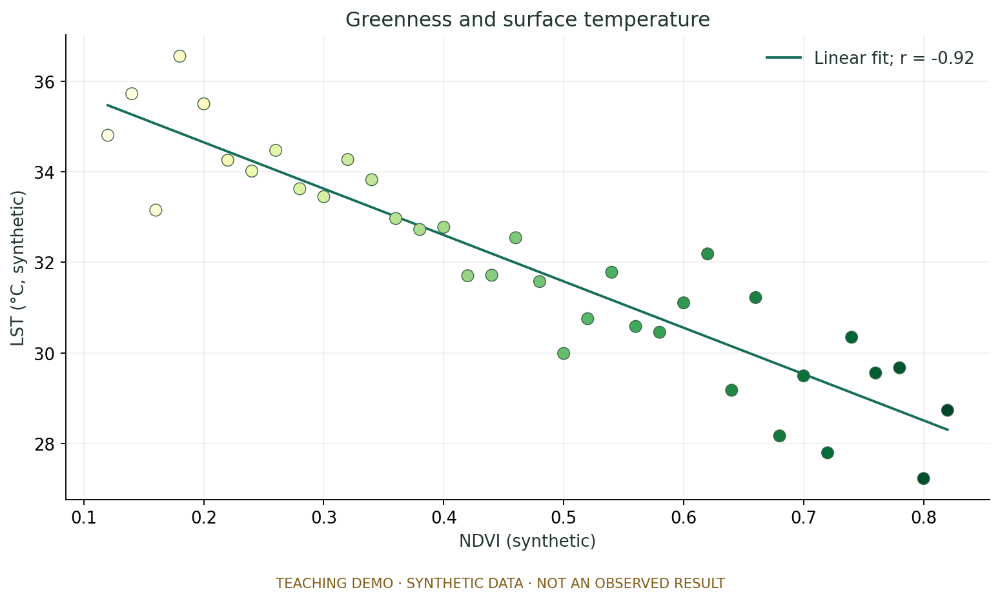
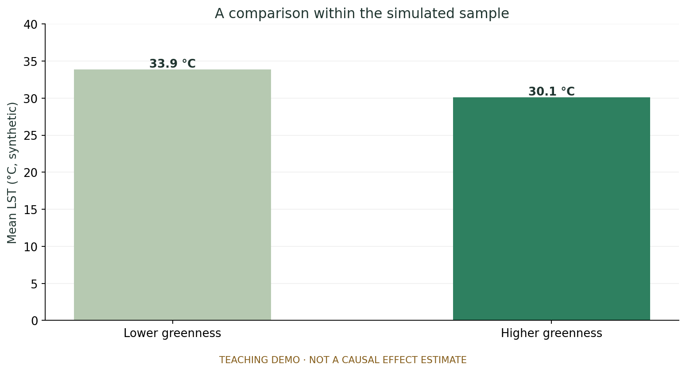
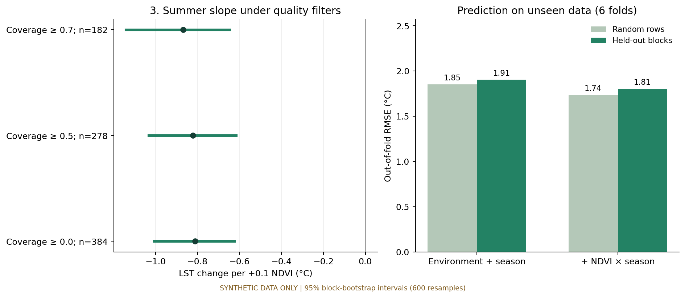

> **교육용 합성자료에 기반한 학술 보고서 예시.** 본문은 실제 도시·Landsat 관측 결과를 제시하지 않는다. 기본 탐색용 36개 표본과 세부목적 분석용 384행은 서로 다른 합성자료이다. 연구 질문을 학술적 목적으로 구체화하는 과정을 보여주기 위해 일상적 질문과 정식 목적 진술을 함께 제시하였다.

### 초록 {#abstract}


**주제어:** NDVI, 지표면 온도, 환경조건 보정, 계절 교호작용, 공간 블록 교차검증, 합성자료

## 1. 연구 배경 {#background}

### 1.1 부산신항 개발과 매립에 따른 공간적 변화

부산신항은 동북아시아 물류 중심 항만의 구축을 목적으로 추진된 대규모 항만 개발사업으로, 부산광역시 강서구 가덕도 북안과 경상남도 창원시 진해구 용원동·웅동·제덕만 일원에 걸쳐 조성되고 있다. 부산광역시의 항만 개발 현황에 따르면 부산신항 개발은 1995년부터 시작되었으며, 부두와 항만 배후단지, 도로 및 철도 등 대규모 기반시설의 확충이 단계적으로 진행되어 왔다[[1]](https://www.busan.go.kr/depart/ocean).

부산신항 개발은 기존 해안지역에 항만시설과 물류단지를 조성하기 위한 매립 및 부지 확장을 포함한다. 이러한 과정에서 기존 해안과 해수면의 경계가 변화하고, 과거 해역이었던 공간이 항만시설과 육상 기반시설로 전환되었다. 부산신항은 장기간에 걸쳐 여러 구간에서 개발이 진행된 지역이므로, 개발 시기에 따라 해안선의 형태와 육상·해양 공간의 구성이 달라졌다는 특징을 가진다.

이처럼 대규모 매립이 이루어진 지역에서 해안선은 단순한 지리적 경계가 아니라 개발에 따른 공간 구조의 변화를 보여주는 중요한 지표이다. 따라서 부산신항의 개발 과정을 이해하기 위해서는 매립에 따른 해안선의 변화와 그에 따른 주변 공간의 변화를 함께 살펴볼 필요가 있다.


그림 1. 부산신항 매립 전과 후 사진[[2]](https://www.mois.go.kr/cmm/fms/FileDown.do?atchFileId=FILE_00130465XriwqSQ&fileSn=0)

### 1.2 매립에 따른 해안선 및 연안 환경 변화의 중요성

연안지역은 육지와 바다가 만나는 공간으로, 해안선의 형태와 수심, 조류 및 퇴적물의 이동 등 여러 자연적 요인이 상호작용하는 환경이다. 이러한 지역에서 대규모 매립과 해안 구조물의 설치가 이루어지면 기존 해안의 형태뿐만 아니라 주변 해역의 물리적 환경에도 변화가 나타날 가능성이 있다.

특히 방파제와 호안 등 해안 구조물의 조성은 파랑과 조류의 흐름에 영향을 줄 수 있으며, 해저 지형과 퇴적물의 이동에도 영향을 미칠 수 있다. 따라서 매립에 따른 해안선 변화는 단순한 육지 면적의 증가를 의미하는 것이 아니라, 연안 공간의 물리적 구조가 변화하는 과정으로 이해할 필요가 있다.

실제로 새만금 방조제 건설에 따른 연안 환경 변화를 분석한 연구에서는 Landsat 시계열을 활용하여 공사 진행 시기에 따른 해수 내 부유물질 농도의 변화를 확인하였다[[3]](https://www.sciencedirect.com/science/article/abs/pii/S0025326X11005650). 이는 대규모 연안 개발이 이루어지는 과정에서 해안선의 변화와 주변 해역의 환경적 특성을 함께 살펴보는 것이 중요하다는 점을 보여준다.

### 1.3 항만 개발지역 인접 내륙의 지표면 온도 문제

항만 및 산업지역은 컨테이너 야적장, 물류시설, 도로 등 다양한 인공시설이 밀집한 공간으로, 일반적인 주거지역이나 자연지역과는 다른 토지 이용 특성을 가진다. 특히 대규모 인공 지표면이 형성된 지역에서는 태양복사에너지의 흡수와 방출 특성이 달라지면서 주변 지역과 구분되는 지표면 온도(Land Surface Temperature, LST) 차이가 나타난다.

부산과 대구를 대상으로 위성 기반 지표면 온도 자료를 활용하여 도시열섬의 시공간적 특성을 분석한 연구에서는 부산의 여름철 최대 지표면 도시열섬 강도가 약 7℃로 나타났으며, 부산의 산업지역에서는 최대 43℃의 지표면 온도가 관측되었다[[4]](https://www.mdpi.com/2072-4292/17/23/3815). 또한 산업지역과 상업지역, 주거지역 사이에서 열환경의 차이가 나타났으며, 토지 이용의 밀도와 공간적 구성에 따라 온도 분포가 달라지는 특성이 확인되었다.

이러한 지표면 온도의 상승은 단순한 미기후 변화를 넘어 인접 지역 주민의 건강과 직결되는 사회적 문제로 이어질 수 있다. 위성 관측 지표면 온도와 폭염 피해의 상관관계를 분석한 연구에 따르면, 2003년 파리 폭염 당시 지표면 온도가 높게 나타난 지역에 거주하는 고령층의 사망 위험이 주변 지역에 비해 약 2.2배 높게 나타났다[5]. 이처럼 높은 지표면 온도는 폭염 시 온열질환 발생 및 건강 취약계층의 피해를 가중하는 주요 요인으로 작용한다.

부산신항 역시 대규모 항만시설과 물류단지가 집적된 지역이라는 점에서 인접한 주거 및 내륙지역의 지표면 온도 변화를 면밀히 살펴볼 필요가 있다. 항만·물류 시설과 인접 내륙지역은 토지 이용과 피복 특성이 상이하므로, 매립과 개발에 따른 지역별 지표면 온도 분포의 차이를 파악하는 것은 연안 도시의 환경적·사회적 영향을 이해하는 데 중요한 의미를 가진다.


그림 2. 유럽 지역별 수목 지역·수목이 없는 도시 녹지·시가화 지역 간 여름철 지표면 온도 차이.[6]

### 1.4 매립 및 항만 개발 주변 해역의 탁도 문제

연안 해역의 탁도는 물속에 존재하는 부유물질과 입자성 물질 등에 의해 물의 투명도가 감소하는 정도를 나타내는 환경적 특성이다. 부유물질은 해수의 빛 투과율을 저하시켜 저서 생태계에 영향을 미치며, 연안 해양환경의 상태를 이해하는 데 중요한 지표로 활용된다.

대규모 매립과 항만 건설 과정에서는 준설, 토사 이동, 해저 지형 변화 등으로 인해 해역 내 부유물질의 분포가 달라질 가능성이 있다. 또한 조류와 해류의 흐름, 강우 및 하천 유입 등 자연적인 요인도 해역의 탁도에 영향을 줄 수 있으므로, 연안 해역의 탁도는 다양한 요인이 복합적으로 작용하는 환경적 지표로 이해해야 한다.

부산 연안 해역의 투명도와 부유물질 분포를 분석한 선행연구에서는 2011년부터 2022년까지의 관측자료를 바탕으로 해역별 부유물질 농도와 투명도의 차이를 확인한 연구 사례가 있다. 특히 부산신항 내측 해역에서는 저층 부유물질 농도가 최대 92.6mg/L로 관측되었으며, 부산 연안 해역이 위치에 따라 서로 다른 부유물질 분포 특성을 보이는 것으로 나타났다[7]. 또한 부산신항 준설과 관련된 해양환경 모니터링 연구에서도 신항 및 진해만 주변의 관측 지점을 대상으로 부유물질 농도의 시기별 변화와 공간적 분포가 분석되었다[[8]](https://www.mdpi.com/2073-4441/17/6/852).


그림 3. 진해신항 부유사 피해.[9]

이러한 부유물질 농도 상승과 탁도 변화는 해양생태계 교란뿐만 아니라 지역 어업 환경에도 영향을 미칠 수 있다. 부산신항과 인접한 진해만 일대는 굴, 피조개 등 패류 양식과 연안 어업이 활발히 이루어지는 해역으로, 부유사의 확산과 침적은 양식 생물의 생육 저하 등 어업 활동에 잠재적인 피해를 초래할 우려가 있다. 따라서 부산신항 개발에 따른 주변 해역의 탁도 변화를 시공간적으로 관측하는 것은 연안 환경 보전과 지역 수산업 보호 측면에서 중요한 과제이다.

### 1.5 부산신항 주변 환경 변화에 대한 종합적 관심의 필요성

부산신항은 장기간에 걸쳐 대규모 매립과 항만시설 및 배후단지 개발이 이루어진 지역으로, 개발 과정에서 육상과 해양의 공간적 구성이 변화해 왔다. 이러한 공간적 변화는 해안선의 형태뿐만 아니라 인접 내륙의 열환경과 주변 해역의 환경적 특성을 함께 살펴볼 필요성을 제기한다.

기존 연구에서는 부산의 산업지역을 중심으로 지표면 온도의 공간적 차이가 확인되었으며, 부산신항 주변 해역에서도 부유물질 농도와 투명도의 지역별 차이가 관측된 바 있다. 이러한 환경적 특성은 각각의 공간과 시기에 따라 다르게 나타날 수 있으므로, 특정 지역의 개발 과정을 이해하기 위해서는 육상과 해양을 구분하여 환경 지표의 변화를 살펴볼 필요가 있다.

특히 부산신항과 같이 매립이 단계적으로 진행된 지역은 해안선의 변화와 인접 내륙 및 주변 해역의 환경적 특성을 함께 이해할 수 있는 중요한 사례이다. 따라서 부산신항의 매립 구간을 중심으로 해안선 변화와 인접 내륙의 지표면 온도, 주변 해역의 탁도 지표가 나타내는 시기별·공간적 특성에 집중한다. 이에 본 연구는 해안선, 지표면 온도, 탁도 지표를 각각 측정하되, 이를 매립 단계라는 같은 시간축에 놓고 비교하고자 한다.


**참고문헌**
1. 부산광역시. 부산신항 개발현황. 부산광역시 해양농수산국. https://www.busan.go.kr/depart/ocean
2. 부산신항 매립 전과 후 사진 https://www.mois.go.kr/cmm/fms/FileDown.do?atchFileId=FILE_00130465XriwqSQ&fileSn=0
3. Ryu, J. H., Won, J. S., & Min, K. D. (2007). Monitoring of suspended sediment variation using Landsat and MODIS in the Saemangeum coastal area of Korea. Continental Shelf Research, 27(17), 2224–2239.
4. Jeon, G.-S.; Kim, W. Resolving Surface Heat Island Effects in Fine-Scale Spatio-Temporal Domains for the Two Warmest Metropolitan Cities of Korea. Remote Sens. 2025, 17, 3815. https://doi.org/10.3390/rs17233815
5. Laaidi K, Zeghnoun A, Dousset B, Bretin P, Vandentorren S, Giraudet E, Beaudeau P. The impact of heat islands on mortality in Paris during the August 2003 heat wave. Environ Health Perspect. 2012 Feb;120(2):254-9. doi: 10.1289/ehp.1103532. Epub 2011 Sep 1. PMID: 21885383; PMCID: PMC3279432.
6. Schwaab et al. (2021), Figure 3a 발췌.
7. 이상협(Sang-Hyub Lee), 장성철(Sung-Chul Jang), and 윤한삼(Han-Sam Yoon). "부산 연안 해수의 투명도와 부유물질의 공간 분포 특성에 관한 연구." 한국해양환경·에너지학회지 25.4 (2022): 171-182.
8. Kim, J.; Ghosh, A.; Paul, T.; Yee, J.-J.; Park, S. Assessing the Environmental Impact of Busan New Port Construction in Korea: A Comprehensive Analysis of Water Quality Changes and Suspended Solids in Jinhae Bay. Water 2025, 17, 852. https://doi.org/10.3390/w17060852
9. "진해신항 해상공사 과정서 흙탕물 발생에 어민들 반발", 동행미디어시대, 2026. 03. 17., 황철성 기자

## 2. 연구 질문 {#question}

연구 배경의 분석 문제를 다음 세 질문으로 구체화하였다. 일상적 질문은 문제의식을 표현하고, 학술적 연구 질문은 비교 대상과 조건을 명시한다. 질문 1–3은 다음 절의 세부목적 1–3에 각각 대응한다.

### 2.1 연구 질문 1

> **일상적 질문:** “부산신항 주변의 바다는 매립 이후 얼마나 줄어들었으며, 해안선은 얼마나 이동했을까?”

**학술적 연구 질문.**  2000~2023년 Landsat 위성영상에서 추출한 시계열 수륙 경계와 연안 수역 면적은 부산신항의 매립 및 항만 개발 단계에 따라 어떻게 변화하였는가?

### 2.2 연구 질문 2

> **일상적 질문:** “바다가 육지로 바뀌고 도로와 물류시설이 들어서면서 매립지와 주변 내륙지역의 지표면 온도는 어떻게 달라졌을까?”

**학술적 연구 질문.** 매립 및 후속 개발 단계에 따른 토지피복 변화는 부산신항 매립지역과 인접 내륙지역의 지표면 온도(LST) 분포에 어떠한 차이를 나타내며, 토지피복 유형별 열환경 특성은 어떻게 변화하는가?

### 2.3 연구 질문 3

> **일상적 질문:** “부산신항 주변 바다에서 탁수 관련 특성이 높은 지역은 어디이며, 항만 내부와 주변 해역에서 어떤 차이가 나타날까?”

**학술적 연구 질문.** Sentinel-2 위성영상에서 산출한 NDTI는 부산신항 주변 해역에서 시기별·공간적으로 어떠한 분포 특성을 나타내며, 항만 내부와 인접 및 외측 해역 사이의 지수값과 상대적 고지수 영역 면적은 어떠한 차이를 보이는가?

## 3. 연구 목적 {#objectives}

### 3.1 전체 연구목적

**본 연구는 부산신항의 매립 및 항만 개발에 따른 해안선과 연안 수역의 변화, 인접 육상지역의 지표면 온도 변화, 주변 해역의 탁수 관련 지표 변화를 정량적으로 파악하는 것을 목적으로 한다.** 여기서 지표면 온도(LST)는 위성에서 관측한 지표면의 열적 상태를 의미하며, 탁수 관련 지표(NDTI)는 수면의 분광 반사 특성을 이용하여 산출한 상대적인 탁수 분포 지표를 의미한다. 본 연구는 위성영상에서 관측 가능한 해안선, 지표면 온도 및 수면의 광학적 특성을 분석 대상으로 하며, 실제 부유물질 농도나 해양생물의 개체 수 변화 등 현장 관측을 통해 확인해야 하는 항목은 직접적인 추론 범위에 포함하지 않는다.

이 목적을 달성하기 위해 세부 연구목적을 순차적으로 구성하였다. 먼저 매립에 따른 해안선 위치와 연안 수역 면적의 변화를 파악하여 부산신항의 연안 공간이 어떻게 전환되었는지 확인한다(세부목적 1). 다음으로 매립지역과 인접 육상지역의 지표면 온도를 비교하여 토지피복 변화 단계에 따른 열환경 차이를 파악한다(세부목적 2). 마지막으로 실제 준설공사 시기를 기준으로 공사 착수 이전과 진행 기간의 주변 해역에서 나타나는 NDTI 변화를 비교하고, 상대적 고지수 영역의 면적과 공간적 분포 특성을 파악한다(세부목적 3). 세 목적은 각각 **매립에 따른 연안 공간의 변화 파악 → 인접 육상지역의 열환경 변화 파악 → 주변 해역의 탁수 관련 지표 변화 파악**에 대응한다.

### 3.2 세부목적 1 · 매립에 따른 부산신항 해안선 위치 및 연안 수역 면적 변화 정량화

**연구 질문 1의 목적화.** 2000년부터 2023년까지의 Landsat 위성영상을 활용하여 부산신항 매립 구간의 시계열 해안선 위치와 연안 수역 면적 변화를 추출하고, 매립에 따른 해안선 이동 및 기존 수역의 육지 전환 규모를 정량화한다.

**필요성 및 평가 지표.** 연안 매립은 기존 해역을 육지로 전환하면서 해안선의 위치와 수역의 공간적 범위를 변화시킨다. 따라서 매립 이전부터 개발 이후까지의 해안선과 수역 면적을 비교하는 것은 부산신항의 매립 규모와 연안 공간의 변화 정도를 파악하는 데 중요하다. 특히 위성영상에서 추출한 해안선은 공간해상도와 촬영 당시의 조위 및 수면 상태에 따라 위치 차이가 발생할 수 있으므로, 가능한 한 동일한 계절과 유사한 관측 조건의 영상을 비교할 필요가 있다. 해안선의 위치 변화, 연도별 연안 수역 면적, 매립에 따른 육지 전환 면적을 주요 평가 지표로 설정하여 시기별 공간 변화 규모를 정량적으로 제시한다.

### 3.3 세부목적 2 · 매립지역 및 인접 육상지역의 토지피복 특성에 따른 지표면 온도 변화 비교

**연구 질문 2의 목적화.** Landsat 위성영상에서 산출한 지표면 온도(LST)를 활용하여 부산신항 매립지역과 인접 육상지역의 시기별 온도 분포를 비교하고, 매립 이후 토지피복 전환에 따른 열환경 차이와 고온지역의 공간적 변화를 파악한다.

**필요성 및 평가 지표.** 매립 직후에는 나지와 매립 토양이 형성되며, 이후 도로, 야적장, 물류시설 및 건축물 등이 조성되면서 지표면의 재질과 구조가 달라진다. 이러한 토지피복 변화는 지표면의 반사율, 수분 상태 및 열 저장 특성에 영향을 미쳐 지표면 온도의 공간적 차이를 발생시킬 수 있다. 또한 매립지역과 인접 내륙지역은 개발 정도와 토지피복 구성이 서로 다르므로, 동일한 시기의 온도 분포를 비교하여 지역별 열환경 특성을 확인할 필요가 있다. 이를 위해 지표면 온도의 평균값과 공간적 분포, 토지피복 유형별 온도 차이를 주요 평가 지표로 설정한다. 추가적으로 정규식생지수(NDVI)와 정규화 건축물 지수(NDBI)를 활용하여 식생 및 시가화 특성과 지표면 온도 사이의 관계를 검토한다.

### 3.4 세부목적 3 · 부산신항 준설공사 전·중 주변 해역의 NDTI 분포 및 상대적 고탁수 영역 변화 정량화

**연구 질문 3의 목적화.** Sentinel-2 위성영상에서 정규화 차이 탁도 지수(NDTI)를 산출하여 부산신항 주변 해역의 탁수 관련 광학적 특성을 파악하고, 실제 준설공사 착수 이전과 진행 기간의 지수값 및 상대적 고지수 영역의 공간적 변화를 비교한다.

**필요성 및 평가 지표.** 준설 과정에서 해저 퇴적물이 재부유하거나 매립 및 항만 개발 과정에서 발생한 토사가 주변 해역으로 이동하면 해수의 부유물질과 탁수 분포에 변화가 나타날 수 있다. 그러나 해양의 탁수 분포는 준설 및 매립뿐 아니라 강수에 따른 육상 유출수, 하천 유입, 조석, 파랑 및 선박 활동 등 여러 요인의 영향을 받으므로, 특정 개발 행위에 따른 결과로 단정하기보다는 시기별·공간별 변화 양상을 비교할 필요가 있다. 이를 위해 실제 준설공사 이력과 위성영상의 촬영 시기를 대조하고, 공사 이전과 진행 기간의 NDTI 평균값 및 분포를 비교한다. 또한 동일한 기준으로 구분한 상대적 고지수 영역의 면적과 유효 관측영상 중 해당 영역이 나타나는 빈도를 평가 지표로 설정하여 주변 해역의 탁수 관련 특성 변화를 정량적으로 파악한다. 이때 NDTI는 실제 부유물질 농도나 탁도를 직접 측정한 값이 아닌 위성영상 기반의 상대적 지표로 해석한다.

## 4. 재료 {#materials}

### 4.1 자료 구성 및 생성 조건 {#advanced-data}

기본 탐색 자료는 seed `2026`으로 생성한 36개 가상 표본이다. NDVI 범위는 0.12–0.82이며, `LST = 37 − 11×NDVI + 무작위 오차`의 생성식을 적용하였다.

세부목적 1–3에는 seed `20261026`으로 생성한 **별도의 384행 합성자료**를 공통으로 사용하였다. 자료는 24개 가상 블록, 블록당 8지점, 지점당 봄·여름 두 관측으로 구성된다. 따라서 고유 지점 수는 192개이며, 384행을 독립적인 384지점으로 해석하지 않는다. 기본 탐색 자료와 세부목적 분석 자료는 생성 과정이 다르므로 두 자료에서 얻은 계수를 직접 비교하지 않는다.

입력 변수는 `block`(공간 집단 번호), `site`(지점 번호), `summer`(봄=0, 여름=1), `ndvi`, `elevation_m`(고도, m), `impervious`(불투수면 비율, 0–1), `coast_km`(해안 거리, km), `valid_fraction`(가상 유효 관측 비율, 0–1), `lst_c`(LST, °C)이다. 실제 좌표나 관측 날짜는 없다.

```text
LST = 28 + 7×summer − (4+5×summer)×NDVI
      − 0.006×고도 + 3×불투수면비율 − 0.12×해안거리
      + 블록오차 + 관측오차
```

NDVI가 높을수록 고도가 높고 불투수면 비율이 낮아지는 경향을 생성 과정에 포함하였다. 같은 블록의 관측에는 공통 오차를 부여하고, 유효 관측 비율이 낮을수록 관측 오차가 커지도록 설정하였다. 생성식의 모든 계수는 교육 목적의 가정이며 외부 문헌에서 추정한 값이 아니다. 따라서 관계의 방향과 계절 차이는 분석 이전에 자료 생성 구조에 포함되어 있다.

[기본 자료 CSV]({{ site.github.repository_url }}/blob/main/03_분석결과/synthetic_samples.csv) · [세부목적 분석 CSV]({{ site.github.repository_url }}/blob/main/03_분석결과/advanced_synthetic_samples.csv) · [공통 분석 코드]({{ site.github.repository_url }}/blob/main/01_공통코드/advanced_analysis.py)

## 5. 방법 {#method}

### 5.1 기초 탐색

산점도와 Pearson 상관계수로 관계를 기술하고, NDVI 0.45 미만·이상 집단의 평균 LST를 비교하였다. 0.45는 교육용 임의 기준이다.

### 5.2 세부목적 1의 분석: 단계적 환경조건 보정

최소제곱법으로 모형 A와 B를 적합하였다. 모형 A는 계절과 NDVI를, 모형 B는 여기에 고도·불투수면 비율·해안 거리를 포함한다. 두 모형은 계절 사이에 동일한 NDVI 기울기를 가정한다. 비교 지표는 NDVI 0.1 증가당 LST 계수(°C)이며, 모형 B의 적합값–잔차 관계를 함께 제시하였다. 잔차 그림은 누락된 구조를 탐색하는 진단 자료로 사용하며 모형의 타당성을 단독으로 확정하는 검정으로 해석하지 않는다.

```text
모형 A: LST ~ NDVI + 계절
모형 B: LST ~ NDVI + 계절 + 고도 + 불투수면비율 + 해안거리
```

### 5.3 세부목적 2의 분석: 계절 교호작용

공통 기울기 가정을 평가하기 위해 모형 B에 `NDVI × summer`를 추가한 모형 C를 적합하였다. 봄 기울기는 NDVI 계수, 여름 기울기는 NDVI 계수와 교호작용 계수의 합으로 산출하였다. 여름−봄 기울기 차이는 교호작용 계수에 해당한다. 계절별 예측선은 고도·불투수면 비율·해안 거리를 전체 표본 평균에 고정하고 두 계절의 NDVI 범위가 겹치는 구간에서 계산하였다.

```text
모형 C: LST ~ NDVI + 계절 + NDVI×계절 + 고도 + 불투수면비율 + 해안거리
봄 기울기 = β_NDVI
여름 기울기 = β_NDVI + β_NDVI×여름
```

### 5.4 세부목적 3의 분석: 민감도 및 공간 블록 교차검증

자료 선택의 민감도는 유효 관측 비율 필터 없음, 0.5 이상, 0.7 이상 조건에서 모형 C를 반복 적합하여 평가하였다. 각 조건의 표본 수, 계절별 기울기 및 구간을 비교하였다. 두 임계값은 예시 조건이며 Landsat의 공식 권장 기준이 아니다.

예측 성능은 품질 필터 적용 전 384행을 대상으로 평가하였다. 24개 블록을 6개 fold로 분할하고 매회 20개 블록으로 학습한 뒤 나머지 4개 블록을 예측하였다. 같은 지점의 두 계절은 동일 fold에 포함된다. 모든 행의 평가 오차를 합쳐 RMSE를 산출하였으며, 계절·고도·불투수면 비율·해안 거리를 포함한 기준 모형과 여기에 NDVI 및 NDVI×계절을 추가한 확장 모형 C를 동일 분할에서 비교하였다.

임의 행 분할 결과는 평가 설계의 영향을 비교하는 보조 지표로 산출하였다. 이 경우 같은 공간 집단의 관측이 학습·평가에 함께 포함될 수 있으므로 새 공간 블록에 대한 성능 추정치로 사용하지 않았다. 그룹 단위 분할의 취지는 [공식 교차검증 문서](https://scikit-learn.org/stable/modules/cross_validation.html#cross-validation-iterators-for-grouped-data)를 참고할 수 있으며, 본 구현은 NumPy를 사용한다.

### 5.5 불확실성 및 재현성

회귀계수의 불확실성은 24개 블록을 복원추출하는 bootstrap 600회로 평가하였다. 선택된 블록의 모든 지점·계절을 함께 포함하여 재적합하고, 추정 분포의 2.5·97.5 백분위수를 95% 구간으로 제시하였다. 계절 차이는 각 반복 내에서 계산하였다. 이는 블록 사이의 독립성과 현재 표본·모형을 전제로 한 근사 구간이며 인과효과의 불확실성을 추정한 것이 아니다. 이 구간을 교차검증 RMSE의 신뢰구간으로 사용하지 않았다.

자료 생성·계산 수치·그림은 저장소의 코드와 연결하였다. 실제 Landsat 분석으로 전환할 경우에는 자료 ID, 분석 지역·기간, 밴드 변환, 구름·수면 처리, 표본 단위 및 집계 기준을 별도로 명시해야 한다. 제공된 GEE 시작 노트북은 별도 실습이며 본 합성자료를 실제 관측으로 검증한 분석은 아니다.

## 6. 결과 {#results}

### 6.1 기초 탐색: NDVI–LST 분포 및 집단 평균



**그림 1.** 기본 합성자료의 NDVI–LST 관계. x축은 NDVI, y축은 LST(°C)이며 모든 점은 가상 표본이다.

36개 표본의 Pearson 상관계수는 **r = −0.92**로 나타났다. 이는 생성식에 설정된 음의 관계와 일치한다.



**그림 2.** 기본 합성자료의 집단별 평균 LST. NDVI 0.45 미만 집단은 **33.9°C**, 0.45 이상 집단은 **30.1°C**였으며 평균 차이는 약 **3.7°C**였다. 이 비교는 표본 내 기술통계이며 모집단 차이의 검정 결과가 아니다.

[기초 탐색 노트북]({{ site.github.repository_url }}/blob/main/02_개인분석/01_demo_analysis.ipynb) · [그림 생성 코드]({{ site.github.repository_url }}/blob/main/01_공통코드/make_demo.py) · [계산 수치]({{ site.github.repository_url }}/blob/main/03_분석결과/summary.json)

### 6.2 세부목적 1 · 환경조건 보정에 따른 연관성 변화 {#deep-confounding}

**대응 연구 질문:** 다른 환경조건을 고려한 이후에도 NDVI–LST의 음의 연관성이 유지되는가?


**그림 3.** 왼쪽은 NDVI 0.1 증가당 계수와 블록 bootstrap 95% 구간, 오른쪽은 모형 B의 적합값과 잔차(관측값−적합값)이다.

계절만 보정한 모형 A의 계수는 **−1.12°C**(95% 구간 −1.25~−0.99°C), 환경조건을 추가한 모형 B의 계수는 **−0.57°C**(−0.79~−0.37°C)였다. 보정 후 계수의 절대 크기는 감소하였으나 음의 방향은 유지되었다. 두 구간 모두 0을 포함하지 않았다. 이 결과는 설정된 모형과 합성 표본에서의 조건부 연관성을 나타내며 환경조건 보정 자체가 인과효과의 식별을 의미하지는 않는다.

[세부목적 1 노트북]({{ site.github.repository_url }}/blob/main/02_개인분석/02_confounding.ipynb)

### 6.3 세부목적 2 · 계절별 연관성의 이질성 {#deep-seasonality}

**대응 연구 질문:** 환경조건을 보정한 NDVI–LST 기울기는 봄과 여름 사이에 차이가 있는가?


**그림 4.** 왼쪽은 다른 환경변수를 전체 표본 평균으로 고정한 계절별 예측선이며 개별 지점의 관측값이 아니다. 오른쪽은 NDVI 0.1 증가당 봄·여름 기울기 및 여름−봄 차이와 블록 bootstrap 95% 구간이다.

모형 C의 봄 기울기는 **−0.34°C**(95% 구간 −0.60~−0.10°C), 여름 기울기는 **−0.81°C**(−1.01~−0.63°C)였다. 여름−봄 차이는 **−0.47°C**(−0.64~−0.31°C)로, 여름의 음의 기울기가 더 크게 나타났다. 차이의 구간이 0을 포함하지 않는다는 결과는 현재 모형과 합성 표본에서 계절별 기울기를 구분할 근거를 제공한다. 이는 생성식에 포함된 계절 차이의 추정 결과이다.

[세부목적 2 노트북]({{ site.github.repository_url }}/blob/main/02_개인분석/03_seasonality.ipynb)

### 6.4 세부목적 3 · 품질 기준 민감도 및 공간 예측 성능 {#deep-robustness}

**대응 연구 질문:** 품질 기준을 변경해도 계절별 추정이 유지되는가? NDVI의 추가가 학습에 포함되지 않은 공간 블록의 예측에 기여하는가?



**그림 5.** 왼쪽은 품질 기준별 여름 기울기와 블록 bootstrap 95% 구간이다. 오른쪽은 임의 행 분할 및 블록 분할에서 기준 모형과 확장 모형의 RMSE를 비교한다. RMSE 막대에는 신뢰구간을 표시하지 않았다.

필터 없음, 유효 관측 비율 0.5 이상, 0.7 이상에서 표본 수는 각각 **384, 278, 182행**이었다. 여름 기울기는 **−0.81, −0.82, −0.87°C/NDVI 0.1**이었으며, 95% 구간은 각각 **−1.01~−0.63, −1.03~−0.62, −1.14~−0.65°C**였다. 모든 조건에서 24개 블록이 유지되었고, 여름 계수의 방향과 0을 포함하지 않는 구간이 유지되었다. 가장 엄격한 기준의 구간은 필터를 적용하지 않은 경우보다 넓었다. 봄 기울기와 계절 차이를 포함한 전체 결과는 계산 파일에 제시하였다.

블록 교차검증 RMSE는 기준 모형 **1.91°C**, 확장 모형 **1.81°C**로, NDVI와 계절 교호작용 추가에 따른 감소량은 약 **0.10°C**였다. 확장 모형의 임의 행 분할 RMSE는 **1.74°C**로 블록 분할보다 낮았다. 이 비교는 품질 필터 적용 전 384행에서 수행하였다. 성능 차이의 유의성 검정은 수행하지 않았다.

[세부목적 3 노트북]({{ site.github.repository_url }}/blob/main/02_개인분석/04_robustness.ipynb) · [전체 추정값·구간·fold별 오차 및 배정]({{ site.github.repository_url }}/blob/main/03_분석결과/advanced_summary.json)

## 7. 토의 {#discussion}

### 7.1 환경조건 보정과 계절 구분의 해석적 의미

세부목적 1에서 환경조건 보정 후 NDVI 계수의 절대 크기가 감소한 결과는, 같은 자료에서도 고려하는 조건에 따라 관계의 추정치가 달라질 수 있음을 보여준다. 본 생성 과정은 NDVI와 고도·불투수면 비율 사이의 관련성을 의도적으로 포함하므로, 이 변화는 환경조건과 함께 나타나는 관계를 검토해야 한다는 설계 취지와 부합한다. 다만 계수의 감소량을 고도 또는 불투수면이 각각 설명하는 인과적 기여율로 해석할 수는 없다. 또한 모형 B는 계절별 동일 기울기를 가정하므로 그 계수는 이 가정 아래의 공통 연관성이다.

세부목적 2는 공통 기울기만으로 요약할 때 소실될 수 있는 계절별 차이를 제시한다. 봄과 여름의 기울기를 구분한 결과는 단일 관계의 크기를 정교화하는 것뿐 아니라, 추정값의 적용 조건을 명시한다는 의미를 갖는다. 그러나 본 자료에서 계절 차이는 이미 생성식에 부여되어 있다. 따라서 이를 녹지의 실제 계절별 냉각 기작을 발견한 결과로 해석할 수 없으며, 관측자료에서 같은 패턴이 나타나더라도 그 기작을 논하려면 추가 근거가 필요하다.

### 7.2 추정의 안정성과 예측 기여의 구분

세부목적 3에서 품질 기준 변경 후에도 여름 계수의 음의 방향이 유지된 결과는 검토한 세 기준 내에서의 방향 안정성을 보여준다. 반면 표본 수 감소와 함께 구간이 넓어진 결과는 엄격한 자료 선택이 곧 추정 정밀도의 향상을 의미하지 않음을 나타낸다. 본 자료의 품질 변수는 인위적으로 생성되었으므로, 실제 결측이 특정 지역·날짜·계절에 집중되는 상황에서의 선택 편향까지 검증한 것은 아니다.

블록 교차검증에서 확장 모형의 RMSE 감소는 약 0.10°C였다. 이 차이의 실용적 중요성은 사용 목적과 허용 오차를 함께 고려하여 판단해야 하며, 현재 예시만으로 충분한 개선이라고 규정할 수 없다. 계수 구간이 0을 포함하지 않는다는 근거는 특정 모형의 연관성에 관한 것이고, RMSE 감소는 보지 않은 표본의 예측 오차에 관한 것이다. 두 지표를 함께 제시함으로써 관계의 존재와 예측상의 유용성을 구별할 수 있다.

임의 행 분할의 오차가 블록 분할보다 낮았다는 결과는 평가 단위에 따라 성능 추정이 달라질 수 있음을 보여준다. 다만 이 차이는 단일 분할 실험에서 얻은 값이며, 그 차이를 일반적인 편향의 크기로 단정하지 않는다. 본 분석은 좌표가 없는 블록을 사용하므로 실제 공간 자기상관의 거리 또는 타 도시 적용 성능을 평가한 것도 아니다.

### 7.3 한계 및 후속 연구 설계

첫째, 본 연구는 단일 생성식과 고정 seed에서 얻은 합성자료 분석이다. 추정 구간과 교차검증 결과를 실제 도시의 모집단 특성으로 일반화할 수 없으며, 여러 생성 조건에서 방법의 성능을 비교한 포괄적 시뮬레이션 연구도 아니다. 후속 검토에서는 오차 크기·변수 간 관련성·블록 수·결측 구조를 달리하여 결과의 의존성을 평가할 수 있다.

둘째, 선형회귀는 지정된 함수 형태와 포함 변수에 의존한다. 비선형 관계, 누락된 환경요인 및 변수 측정오차는 추정에 영향을 줄 수 있다. 블록 bootstrap 역시 블록 간 독립성을 전제로 하며 24개 블록과 600회 재표집에서 얻은 구간의 정밀도에는 제약이 있다. 계절별 구간의 분리만으로 생태·물리적 기작을 확정하지 않는다.

셋째, 두 계절과 단일 6-fold 분할은 연중 변화·장기 추세·미래 연도 예측을 평가하기에 충분하지 않다. 실제 위성자료 연구로 확장할 때에는 NDVI와 LST의 공간·시간 대응, 구름 및 수면 처리, 계절별 관측일과 표본 대표성을 확인하고 목적에 맞는 공간·시간 분할을 설계해야 한다. 지표면 온도에 관한 결과를 기온이나 일평균 온도에 대한 결론으로 대체해서도 안 된다.

마지막으로 본 예시의 학술적 기능은 연구 질문과 분석·해석 범위의 대응을 시연하는 데 있다. 실증적 신규성이나 선행연구 대비 우수성을 주장하지 않는다. 실제 보고서에서는 관련 일차 문헌을 검토하여 연구 공백을 설정하고, 결과의 일치·차이를 대상 지역·기간·표본 단위·방법 차이와 연결해 논의해야 한다.

## 8. 결론 {#conclusion}

본 연구는 합성자료를 이용하여 NDVI–LST 관계를 환경조건 보정, 계절별 이질성, 자료 선택 민감도 및 공간 예측 성능의 측면에서 평가하였다. 세부목적별 결론은 다음과 같다.

1. **세부목적 1 — 조건부 연관성.** NDVI 0.1 증가당 계수는 계절만 보정했을 때 −1.12°C, 환경조건을 추가했을 때 −0.57°C였다. 이 결과는 관계의 크기를 제시할 때 보정 조건을 명시해야 함을 보여주며, 녹지의 인과적 냉각 효과를 추정한 결과는 아니다.
2. **세부목적 2 — 계절별 이질성.** 봄과 여름의 기울기는 각각 −0.34°C와 −0.81°C였고, 여름−봄 차이는 −0.47°C(95% 구간 −0.64~−0.31°C)였다. 설정된 생성 구조와 모형 아래에서 하나의 공통 기울기만으로는 계절 차이를 충분히 나타내지 못하였다.
3. **세부목적 3 — 민감도와 예측 성능.** 세 품질 기준에서 여름 계수의 방향은 유지되었으나, 가장 엄격한 조건에서는 표본 수가 줄고 구간이 넓어졌다. NDVI와 교호작용 추가에 따른 블록 교차검증 RMSE 감소는 약 0.10°C였다. 관계 추정의 안정성과 예측 기여는 구분하여 판단할 필요가 있다.

이상의 결과는 연구 질문을 조건·추정량·평가 기준이 명시된 세부목적으로 구체화하고, 각 목적에 대응하는 근거와 한계를 제시하는 분석 절차를 예시한다. 실제 도시 환경에 대한 결론은 관측자료와 적절한 검증 설계에 기반한 후속 분석을 통해 별도로 도출해야 한다.

---

### 부록 · 재현성 및 연구 기여 {#reproduce}

#### 직접 실행하기

[Colab에서 합성자료 노트북 열기](https://colab.research.google.com/github/{{ site.github.owner_name }}/{{ site.github.repository_name }}/blob/main/02_개인분석/01_demo_analysis.ipynb)

심화 분석도 EE 인증 없이 실행됩니다. 공통 자료 준비 블록을 먼저 실행하고 해당 분석 셀을 따라가세요.

- [세부목적 1: 환경조건 보정 — Colab](https://colab.research.google.com/github/{{ site.github.owner_name }}/{{ site.github.repository_name }}/blob/main/02_개인분석/02_confounding.ipynb)
- [세부목적 2: 계절별 관계 — Colab](https://colab.research.google.com/github/{{ site.github.owner_name }}/{{ site.github.repository_name }}/blob/main/02_개인분석/03_seasonality.ipynb)
- [세부목적 3: 강건성·공간 검증 — Colab](https://colab.research.google.com/github/{{ site.github.owner_name }}/{{ site.github.repository_name }}/blob/main/02_개인분석/04_robustness.ipynb)

GitHub 저장소의 코드를 로컬에서 실행하려면 다음을 사용합니다.

```text
python -m pip install -r requirements.txt
python 01_공통코드/make_demo.py
python 01_공통코드/advanced_analysis.py
```

예시 합성 분석은 2026-10-26 로컬 환경에서 실행 확인했습니다. GEE 시작 노트북의 실제 서버 실행은 검증하지 않았습니다.

[별도 연습: GEE 시작 노트북](https://colab.research.google.com/github/{{ site.github.owner_name }}/{{ site.github.repository_name }}/blob/main/01_공통코드/01_gee_starter.ipynb)

#### 조원별 기여를 쓰는 방법

실제 조에서는 “조원 A: 공통 전처리 및 품질 점검 / 조원 B: 공간 비교 / 조원 C: 시계열 분석”처럼 **분석 내용과 연결된 기여**를 기록하세요. 위 역할은 작성 예시이며 실제 참여자 명단이 아닙니다. 별도 주간 보고서는 만들지 않아도 됩니다.

#### 자료와 참고

- 합성자료: 이 저장소의 생성 코드, seed 2026(기본), 20261026(심화). 외부 관측 데이터 사용 없음.
- [Landsat 8 Collection 2 Level-2 공식 자료 설명](https://developers.google.com/earth-engine/datasets/catalog/LANDSAT_LC08_C02_T1_L2)
- [학생 사용 안내]({{ site.github.repository_url }}/blob/main/STUDENT_GUIDE.md)
- [빈 보고서 틀](report-template.html)

- [섹션별 작성 지침]({{ site.github.repository_url }}/blob/main/05_보고서양식/섹션별_작성지침.md)


#### 연구 배경 참고문헌

- Voogt, J. A., & Oke, T. R. (2003). Thermal remote sensing of urban climates. *Remote Sensing of Environment, 86*(3), 370–384. [https://doi.org/10.1016/S0034-4257(03)00079-8](https://doi.org/10.1016/S0034-4257(03)00079-8).
- Schwaab, J., Meier, R., Mussetti, G., Seneviratne, S., Bürgi, C., & Davin, E. L. (2021). The role of urban trees in reducing land surface temperatures in European cities. *Nature Communications, 12*, 6763. [https://doi.org/10.1038/s41467-021-26768-w](https://doi.org/10.1038/s41467-021-26768-w).
